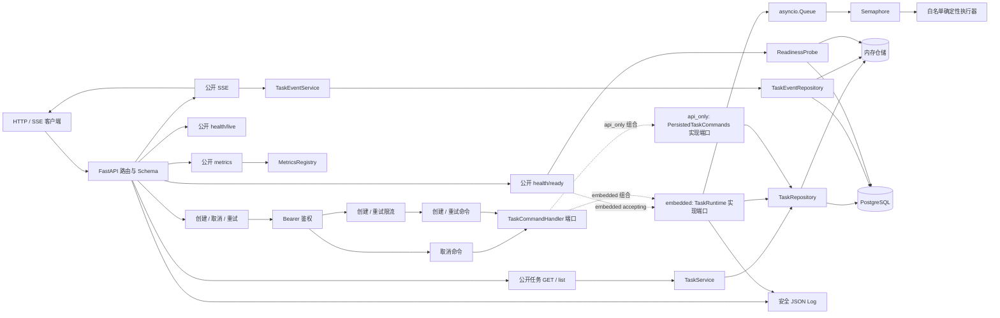
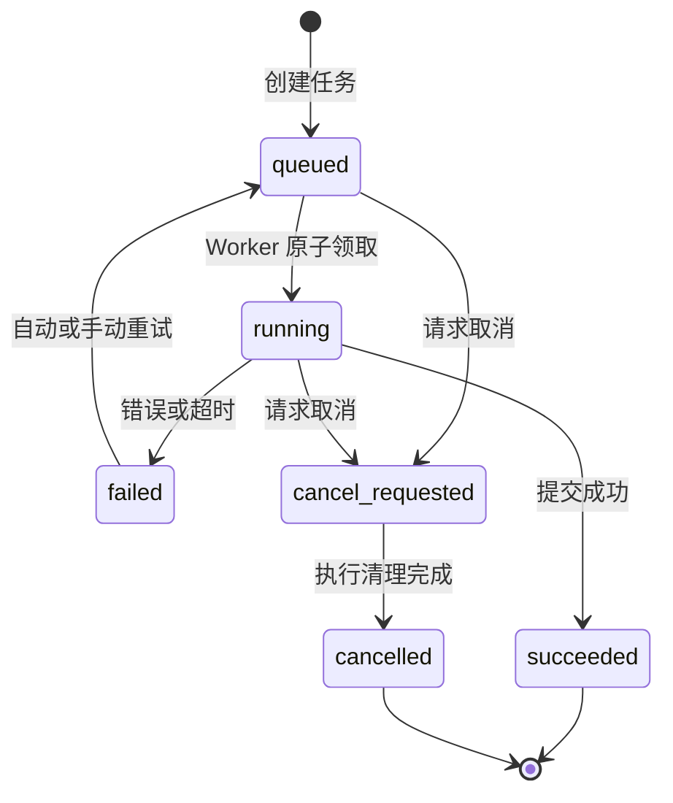
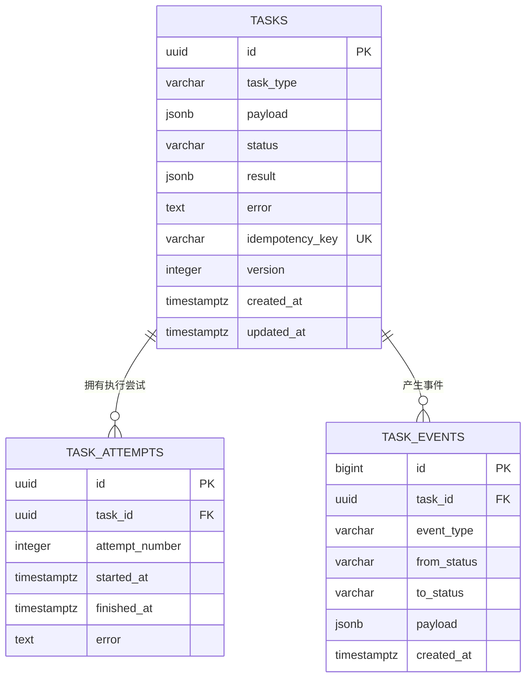
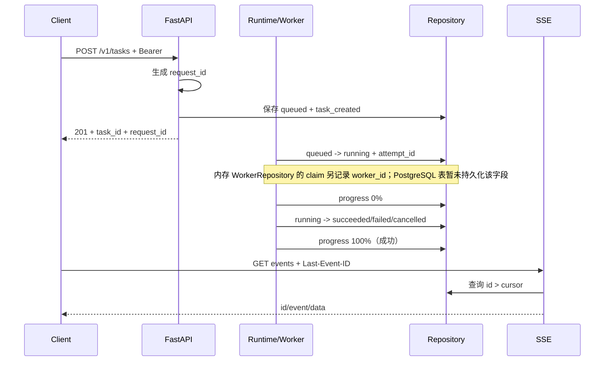

# 阶段一架构、状态机与表关系

本页描述 `0.8.0` 的实际实现，不把尚未完成的 PostgreSQL 独立 Worker 能力画成现状。

## 1. 当前架构

`main.py` 使用 `embedded` 模式，API 与进程内 Runtime 同进程运行。`api_main.py` 是只持久化命令的 `api_only` 入口；在 PostgreSQL Worker 原子领取 SQL 完成前，它不能单独推进任务。

## 2. 任务状态机

`succeeded` 与 `cancelled` 是终态。每次转换必须经过 `Task.transition_to()`；Repository 在同一临界区或事务中完成读取、校验、状态更新、attempt/event 写入。

## 3. PostgreSQL 表关系

关键约束：

- `tasks.idempotency_key` 的非空值唯一，解决并发重复创建；
- `task_attempts(task_id, attempt_number)` 唯一，保证同一任务的审计序号不重复；
- `task_events.id` 全局递增，SSE 以 `Last-Event-ID` 作为已确认游标；
- `tasks.version` 记录状态版本，不替代数据库事务或行锁。

## 4. 请求到事件的关联链

日志只输出白名单字段。`request_id`、`task_id`、`attempt_id`、`worker_id` 用于关联，不记录请求体、payload、API Key 或原始异常文本。

## 5. 已知边界

- Compose 当前运行 `API + 内嵌 Worker + PostgreSQL`，并非独立 PostgreSQL Worker；
- 强制中断与租约恢复由内存 `WorkerRepository` 演示和测试，跨进程恢复等待第四周 SQL；
- `/metrics` 是单进程内存快照，不持久、也不跨容器聚合；
- 并发基线用于记录变化趋势，不是生产容量结论。

内存 `AttemptRecord` 还包含 `worker_id/outcome/lease_expires_at/retry_at` 等租约审计信息；这些字段尚未进入 PostgreSQL ORM 和迁移，因此没有出现在上面的数据库 ER 图中。
