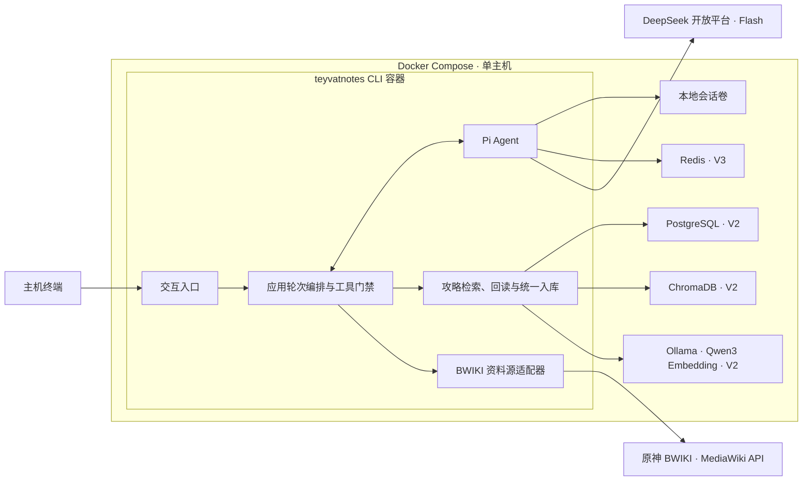

# TeyvatNotes 架构设计

> 本文描述基于 Pi Agent 的重做版目标架构。交付范围和验收标准以 [软件需求规格说明书](requirements.md) 为准。

## 1. 系统边界

TeyvatNotes 通过 Docker Compose 部署在单台主机上，用户在主机终端进入容器中的 `teyvatnotes` CLI。Pi Agent 提供模型、工具循环和会话能力。TeyvatNotes 在其上实现原神攻略检索、联网补充、玩家条件与引用校验。V1 交付 CLI 容器，V2 加入 PostgreSQL、ChromaDB 和本机 Ollama 容器，V3 加入 Redis。外部回答模型与原神 BWIKI 资料源是独立的依赖。

V1 用受控模型和工具验收 CLI、Pi 循环与会话恢复，不要求真实模型或正式原神问答。V2 首批仅做角色配队，含通用配队和按已确认库存配队；真实闭环以标准角色为范围，不要求明确版本的正式资料。培养、配装、任务与解谜、机制问答不纳入 V2 首批。[需求概述](requirements.md#2-项目概述) · [待决项](requirements.md#85-待决项与建议)



## 2. 组件与技术选型

| 组件        | 职责                                                      | 技术选型                                                                                                              |
| --------- | ------------------------------------------------------- | ----------------------------------------------------------------------------------------------------------------- |
| CLI       | 收集问题与补充条件，管理会话切换，展示工具活动、答复、引用和错误。提供攻略导入与维护入口。           | TypeScript、Node.js                                                                                                |
| 部署与编排 | 构建 CLI 镜像，管理依赖服务、容器网络及持久卷。 | Docker Compose，采用 `docker compose` 命令。 |
| Pi 接入层    | 嵌入 Pi 会话，处理模型调用、工具分派、上下文压缩和运行事件。                        | TypeScript、Node.js、Pi 官方 SDK `@earendil-works/pi-coding-agent`                                                    |
| 上下文缓存 | 按会话缓存已确认条件、历史压缩摘要等可重建的上下文数据。 | Redis（V3），通过 Node.js 客户端 `redis` 接入。[Redis 客户端文档](https://redis.io/docs/latest/develop/clients/nodejs/) |
| 问答控制与领域规则 | 管理本轮已确认条件、工具权限、预算和证据授权，校验最终回答。通过接口访问攻略存储和外部来源，支持离线独立测试。 | 应用内领域接口与校验逻辑                                                                                                      |
| 模型 | 根据本轮上下文与工具结果决定下一步，生成攻略答复。 | DeepSeek 开放平台，模型 `deepseek-flash`，通过 Pi 接入 OpenAI 兼容的 Responses API。 |
| 攻略库       | 保存攻略正文、版本、分块、发布状态、来源及引用位置，提供关键词筛选所需的业务数据。               | PostgreSQL                                                                                                        |
| 向量索引      | 保存分块向量、分块标识及粗筛所需的元数据，提供语义召回。                            | ChromaDB，TypeScript 使用官方 `chromadb` 客户端。 [Chroma 客户端文档](https://docs.trychroma.com/docs/run-chroma/client-server) |
| Embedding | 将攻略分块和查询文本向量化。 | 本机 Ollama，模型 `qwen3-embedding`，调用 `POST /api/embed`。[模型](https://ollama.com/library/qwen3-embedding) · [Ollama 接口](https://docs.ollama.com/api/embed) |
| 检索 | 按角色、攻略类型、获准游戏版本限定候选。库存和前提不过滤可回读的原文。 | PostgreSQL 关键词、ChromaDB 向量及 TypeScript RRF 融合。 |
| 入库与联网资料源 | 搜索获准的候选并读取正文，将手工资料和网络正文交给同一入库流程。 | Markdown、JSON 与独立的 BWIKI MediaWiki 适配器。 |

选择 Pi SDK 和 Node.js 版本时，优先参考本机已安装且兼容项目的版本；没有可用版本时选择各自最新的官方免费稳定发行版并确认兼容性。镜像内固定实际使用的 Node.js 版本和 Pi SDK 依赖，容器部署在主机上无需另装这两项。 [Pi 官方 SDK 文档](https://docs.pi.dev/latest/sdk) · [DeepSeek 官方模型文档](https://api-docs.deepseek.com/quick_start/pricing/)

正式模型请求使用 DeepSeek 开放平台的 `https://api.deepseek.com`，调用 `POST /responses`。DeepSeek 的 Responses API 采用无状态请求。Pi 在请求的 `input` 中传递所需的消息、工具调用及工具结果；上下文以本地会话为依据，V3 可复用 Redis 中的派生数据。 [DeepSeek Responses API 指南](https://api-docs.deepseek.com/guides/responses_api/)

V2 的 Ollama 只负责本地 Embedding，回答仍由 DeepSeek 生成。后续如需将回答模型也迁到 Ollama，可通过 Pi 的模型配置接入无状态 `POST /v1/responses`，并验证所选模型的工具调用、工具结果续接与回答校验。 [Ollama OpenAI 兼容接口](https://docs.ollama.com/api/openai-compatibility)

上述是 V2 已选定的默认实现。回答模型、联网适配器与 Embedding 分别配置，替换其中一项需重跑对应验收，不改变攻略数据或引用边界。

### 2.1 项目模块级目录结构

以下是本项目的目标目录，按模块职责划分，不是当前仓库文件清单。目录随 §8 的交付阶段逐步落地，V1 不引入 V2 的检索与联网服务、V3 的 Redis 或 V4 的扩展依赖。

```text
TeyvatNotes/
├── package.json          # CLI 入口与 Node.js 依赖声明
├── tsconfig.json         # TypeScript 构建配置
├── Dockerfile            # CLI 镜像
├── compose.yaml          # 单机服务、网络与持久卷
├── src/
│   ├── cli/              # 命令解析、交互终端和结果展示
│   ├── bootstrap/        # 读取配置、装配用例与适配器
│   ├── application/      # 轮次、预算、工具授权、检索与入库编排
│   │   └── ports/        # 运行时、会话、存储、向量化、资料源与缓存接口
│   ├── domain/           # 术语、配队条件、适用范围、RRF 和引用规则
│   └── adapters/
│       ├── pi/           # Pi SDK、回答模型、本地会话提交与恢复
│       ├── postgres/     # 攻略原文、元数据、关键词查询与发布状态
│       ├── chroma/       # 向量索引与语义召回
│       ├── ollama/       # 本地 Embedding
│       ├── web/          # BWIKI 原生 API、来源约束与原文元数据提取
│       └── redis/        # V3 可重建的派生上下文缓存
├── migrations/           # 新版 PostgreSQL 表结构迁移
├── resources/
│   ├── terminology/      # 已确认的标准专名与别名
│   ├── skills/           # V4 受控加载的领域 Skills
│   └── extensions/       # V4 显式启用的可信扩展
├── tests/
│   ├── unit/             # 领域规则和应用用例
│   ├── integration/      # SDK、存储与服务适配器契约
│   ├── acceptance/       # CLI／Compose 端到端及 AT 用例
│   └── fixtures/         # 隔离测试用的固定资料与模拟响应
└── docs/
    ├── requirements.md   # 产品需求及验收标准
    ├── architecture.md   # 系统边界、技术选型与部署拓扑
    └── design.md         # 模块内部实现、接口与状态转换
```

依赖方向为 `cli → application → domain`。`bootstrap` 负责装配具体实现，`adapters` 实现 `application/ports`；应用和领域不直接依赖 Pi SDK、HTTP 客户端或数据库客户端。会话、数据库、向量索引和本地模型文件由 Compose 卷管理，不写入源码目录；凭据从运行环境注入。模块职责详见[详细设计 §1](design.md#1-模块与交付边界)，验收对应 NFR-005、IF-005 与 AT-11。

## 3. 问答与联网补充

V2 的查询范围以标准角色、版本查询意图和配队目标为基础。库存只影响建议的可用性，不阻止给出配队思路或参考；明确为空不等于缺失。具体版本、最新查询及用户同意后的版本未知参考由应用确定并冻结；Pi 不能切换范围。规则见 [FR-006](requirements.md#fr-006-工具驱动的攻略问答与引用) 和[版本查询与确认](design.md#211-版本查询与确认)。Pi 根据模型输出和工具结果决定下一步，应用在每次执行前检查权限、参数、查询范围和预算。

| 工具 | 开放条件与效果 |
| --- | --- |
| `search_guides` | 在本轮确认范围内查找已发布攻略，返回候选与摘要。明确区分命中、正常未命中和查询错误。 |
| `read_guide` | 仅回读批次开始前已回送、且属于本轮确认范围的候选。成功取得完整证据后才授予本轮引用资格。 |
| `search_web_guides` | 仅在正常未命中已经回送、本轮从未命中且尚未执行补查后开放。Pi 决定是否调用及搜索词，应用每轮最多执行一次；不得跟查库同批执行。 |

### 库内命中与未命中

1. **库内命中**。Pi 回读候选并使用完整证据。命中后关闭本轮联网入口；换词搜空或同批同时返回 `hit` 与 `miss` 都不会重新开放。回读截断可改读其他已授权候选，不能借此触发外搜。
2. **正常未命中**。两路检索均正常结束而无本轮合格候选时才返回 `miss`。结果回送后，Pi 可在后续批次调用一次补查，也可结束。明确版本仍无匹配时，应用仅在存在合格的未知版本资料时询问用户是否接受参考；同意后在新轮启用，不继承旧证据。条件不足和依赖故障不算 `miss`。
3. **联网补充**。应用按 [FR-005](requirements.md#fr-005-攻略导入混合检索与联网补充) 判断能否发布，再核对本轮是否可检索。Pi 在后续批次用原问题和范围重检，待候选回送后再回读并引用；本轮不再开放第二次补查。缺正文、缺最低证据、索引故障或重检仍无匹配时返回对应缺口或错误；已合法回读但不足以组成整队，按 FR-006 返回能够核对的部分及缺口。

同一批工具调用不得使用本批尚未回送的查库结果取得新权限。补查工具不接收检索参数，出站角色由应用从冻结范围取得。发布、候选授权和答复分别判定。Pi 根据合法回读给出配队思路，可附综合配队建议；应用按 [FR-006](requirements.md#fr-006-工具驱动的攻略问答与引用) 校验结构、引用定位和当前可用性，不验证原文是否列出同一套四人队。[轮次授权与批次校验](design.md#31-轮次授权状态与批次校验)

### BWIKI 网络攻略适配器

V2 在 `adapters/web` 下通过既有 `GuideSource` 端口接入独立的 BWIKI MediaWiki 适配器。Pi 只提出检索词和工具调用，不直接访问 HTTP、指定 URL 或获得读取网页的通用工具；应用控制查库未命中、来源许可、单次补查和每个出站请求的预算。回答模型的 Responses API 链路不变，资料源不复用回答模型密钥。

适配器只通过原神分站原生 API 发现候选，校验来源和路径后读取固定修订的指定章节；不走第三方搜索、HTML 抓取或失败回退。适配器把规范化正文、原文定位和来源依据交给既有入库流程，不自行发布或授予引用。已发布内容仍须通过重检、回读才能引用。真实补查在 [AT-10 放行条件](requirements.md#85-待决项与建议)未满足前不启用；请求契约见[详细设计 §5](design.md#5-bwiki-联网资料源)。

## 4. 攻略数据与检索

**入库。** 手工 Markdown、JSON 与联网取得的正文使用统一处理管线。按 [FR-005](requirements.md#fr-005-攻略导入混合检索与联网补充)，适配器把可定位的正文和能提取的元数据交给入库用例；完整阵容和适用条件不是 BWIKI 的发布门槛。PostgreSQL 保留已知与未知的区别，ChromaDB 对合格正文分块建索引，不要求每块包含四人名单。不能通过 FR-005 最低证据校验的正文不参与检索与引用。手工导入契约不变。

**版本与发布。** 同一来源、规范化内容与处理版本重复导入时复用已有版本；内容变化生成新版本，旧证据与引用位置保持可查。入库先在 PostgreSQL 保存不可检索的文档版本及分块，再生成向量并写入 ChromaDB。向量按分块 ID 和 Embedding 配置关联。来源和最低元数据合格、且索引确认可查询后，联网补充才自动发布。索引失败或未就绪则保持不可检索。维护者导入仍区分待发布、已发布和校验失败。网络读取、Embedding 调用与 ChromaDB 写入不占用 PostgreSQL 事务。

**本地向量化。** 入库分块和查询文本都通过本机 Ollama 的 `POST /api/embed` 向量化，与回答模型和联网资料源独立配置。固定使用的 `qwen3-embedding` 模型标签和向量维度，将具体配置与 ChromaDB 索引关联。切换 Embedding 模型或向量维度时，用新配置重建索引；确认可查询后再切换，不混用不同配置的向量。

**混合检索与引用。** PostgreSQL 为范围与正文权威来源，ChromaDB 提供语义召回。按授权版本层过滤，按分块 ID 去重并以 RRF 融合。库存冲突和前提未知移交答复层判定可用性，不阻止回读。CLI 先展示配队思路，再展示可选的模型组合，引用由应用从本轮证据生成（FR-005、FR-006）。

候选命中用于授权回读，正文与引用统一从 PostgreSQL 回读。Ollama 向量化或 ChromaDB 查询失败属于检索故障，不算正常未命中，也不触发联网补查。

## 5. 会话、上下文与扩展

| 能力 | 架构边界 |
| --- | --- |
| 会话 | 复用 Pi 本地追加式会话。区分同一玩家全局库存、角色或版本专属条件、目标约束和任务进度。换角色、版本或目标不继承不适用的条件；旧引用可查看，不能直接用于新轮次。中断只保留已确认且已持久化的条件，不重放工具。 |
| 上下文 | 从会话、系统提示、已确认条件、本轮证据及相关 Skill 构建模型输入。V3 用 Redis 缓存派生数据，由 Pi 压缩历史，由应用检查 Token 预算、工具调用与结果的配对及证据范围。摘要涉及的模型调用计入预算。 |
| 活动与诊断 | CLI 订阅 Pi 的运行事件，展示轮次、模型、工具和终止原因。运行事件用于进度或诊断，会话记录用于恢复历史和重建上下文。 |
| Skills 与插件 | V4 从受控目录加载领域 Skills。显式启用可信插件，通过 Pi 扩展接口注册领域工具及监听事件。应用继续负责工具权限和证据范围。 |

### Redis 上下文缓存

本地会话是历史、确认条件和轮次状态的权威记录。应用按会话标识、所依据的会话事件位置和上下文配置版本定位 Redis 缓存，并设置可配置的过期时间（TTL）。Redis 保存可由本地记录重建的确认条件、压缩摘要及其对应的事件位置；Pi 和应用继续负责组装、裁剪和压缩，Redis 本身不执行这些操作。[Pi 上下文压缩参考](https://docs.pi.dev/latest/compaction) · [Redis 键过期文档](https://redis.io/docs/latest/commands/expire/)

历史或规则变更时不复用旧缓存。缓存缺失、过期或服务不可用时，从本地会话在预算内重建上下文，不重放历史工具调用。最终模型输入仍需检查预算和工具调用配对；本轮引用资格只来自本轮合法回读，不从 Redis 或摘要恢复。离线查看历史不依赖 Redis。

## 6. 预算、安全与故障处理

- 模型请求、合法工具执行、候选发现和正文读取分别计数，共用从接收非空输入到终态的总时限。每次实际 API 请求受单步超时约束；分块、Embedding、索引可见及重检均计入本轮。被拒调用另记，实际用量和估算分开记录。补查基准见[需求 §8.4](requirements.md#84-v2-补查用例的预算口径)，具体上限待定。
- 模型工具调用须通过白名单、参数、调用标识和数据范围校验。Pi 通用编码工具和未登记扩展默认停用。取消、超时、不可恢复错误或预算耗尽后停止后续调用。失败轮次不得自动重发。
- 本地会话与 PostgreSQL 攻略资料分开存储。只将所需上下文发送给模型，只将必要搜索参数发送给网络来源。模型凭据从本地配置注入，普通诊断记录关联标识、阶段、耗时、用量与错误分类。网页、攻略和工具结果均作为外部数据处理。
- Redis 默认不对公网开放。缓存按会话隔离，不存模型密钥或完整会话日志；Redis 读写超时计入本轮预算。
- 旧资料与会话保留在原位置。只有另行批准迁移范围后才使用独立工具写入目标环境。

## 7. Docker Compose 部署边界

- **应用与依赖分开运行**。Compose 只提供一个 `teyvatnotes` 应用服务，承载问答、会话和维护子命令；依赖容器在后台独立运行。CLI 通过服务名访问依赖，默认不映射服务端口，不提供公网入口。[Compose 网络](https://docs.docker.com/compose/how-tos/networking/)
- **数据独立于容器**。Pi 会话、PostgreSQL 数据、ChromaDB 索引和 Ollama 模型分别挂载命名卷。Redis 用作可丢失缓存，停机或重建不会影响本地会话恢复。维护者导入目录单独只读挂载；凭据由部署环境以运行时密钥注入，不进入镜像或仓库。[Compose 数据卷](https://docs.docker.com/reference/compose-file/volumes/)
- **启动与就绪分开判断**。需要攻略问答时先启动 V2 核心依赖，并验证数据库初始化、索引和指定 Embedding 模型已就绪。仅查看历史时不要求依赖容器或 DeepSeek 可用，Redis 也不是 CLI 启动条件。
- **旧部署保持隔离**。新版 Compose 只编排新版 CLI 和所需依赖，使用新的项目和数据卷，不接管旧桌面服务的数据库或卷。配置、命令和停机步骤见[详细设计](design.md#8-compose-部署设计)。

## 8. 分阶段交付

| 阶段 | 实现边界与验收 |
| --- | --- |
| V1 Pi 接入 | Compose 运行真实 CLI 和 Pi SDK；用受控模型验收工具循环、权限、停止及会话恢复。不依赖真实模型或 V2 攻略库。对应 AT-01 至 AT-04、AT-11。 |
| V2 攻略 RAG | 在隔离 Compose 环境验证两路召回、RRF、发布门槛、会话条件继承、配队思路、可选阵容建议及引用校验。联网补查须通过模拟 BWIKI API 回归，并按 AT-10 验证真实资料从候选发现、读取到入库、带引用答复和下轮复用。对应 AT-03 至 AT-06、AT-10、AT-11。 |
| V3 上下文 | 加入 Redis 服务，覆盖长会话预算、压缩、缓存命中、失效和服务停机后的重建。对应 AT-07、AT-11。 |
| V4 Skills 与扩展 | 验证按需加载攻略 Skill、通过 Pi 扩展登记工具及监听事件，并验证权限和诊断脱敏。对应 AT-08。 |
| V5 增强 | 按选定范围交付流式交互、运行中引导、重试、追踪、评测或外部扩展。对应 AT-09。 |

正式角色与版本、真实联网验收的来源许可与正文读取条件、正式题集和质量阈值，以及预算数值，遵循[需求 §8.5](requirements.md#85-待决项与建议)。Python 模块复用、具体 Embedding 标签与维度、分块与召回参数、压缩阈值、终端支持和旧数据迁移留待后续细化。
