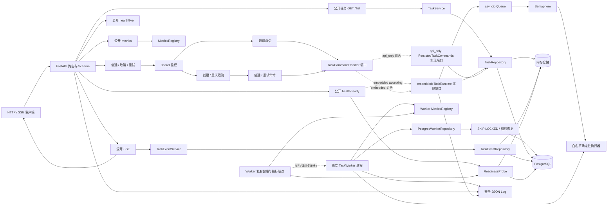
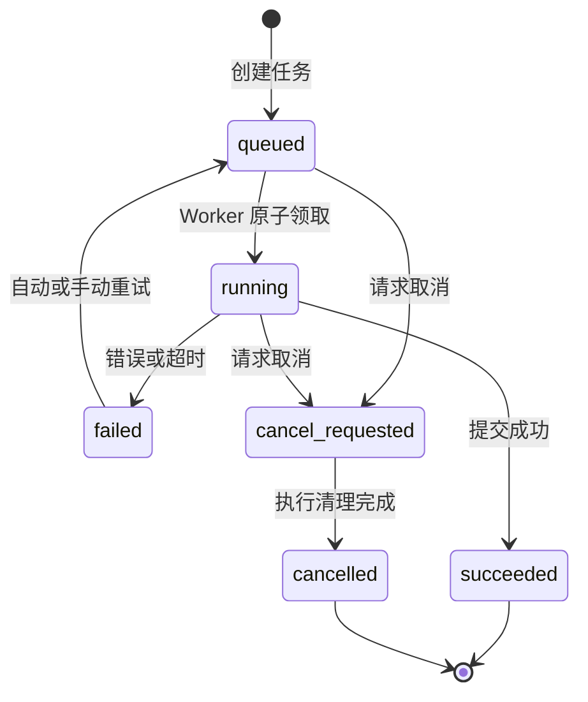
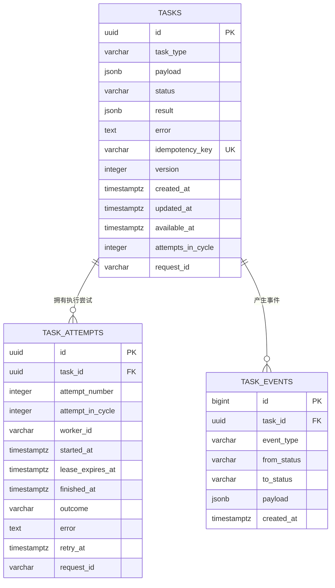
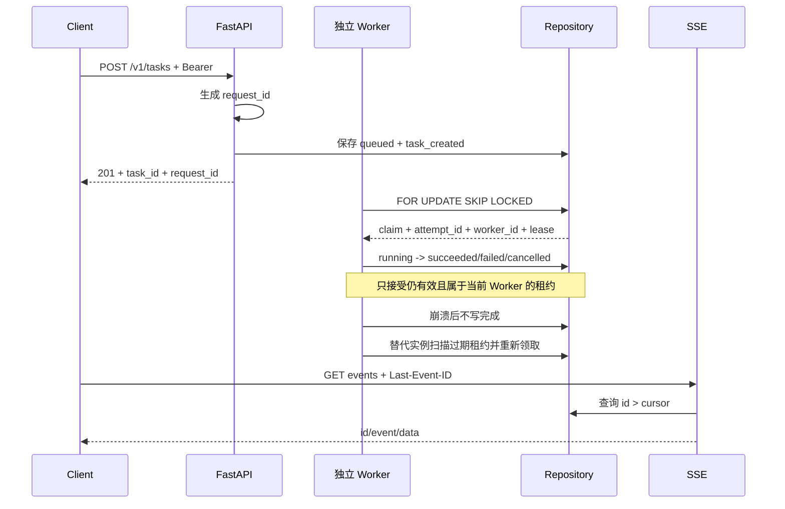

# 阶段一架构、状态机与表关系

本页描述 `0.8.1` 的实际实现：Compose 中 API 与独立 Worker 通过 PostgreSQL 协作；`main.py` 仍保留内存/教学用 embedded 模式。

## 1. 当前架构

`main.py` 使用 `embedded` 模式，适合无数据库教学。Compose 的 API 使用 `api_only`，只持久化命令；`worker_main.py` 创建独立 Engine、`PostgresWorkerRepository` 和 `TaskWorker`，用 PostgreSQL 原子领取并推进任务。

## 2. 任务状态机

`succeeded` 与 `cancelled` 是终态。每次转换必须经过 `Task.transition_to()`；Repository 在同一临界区或事务中完成读取、校验、状态更新、attempt/event 写入。

## 3. PostgreSQL 表关系

关键约束：

- `tasks.idempotency_key` 的非空值唯一，解决并发重复创建；
- `task_attempts(task_id, attempt_number)` 唯一，保证同一任务的审计序号不重复；
- `task_attempts(task_id) WHERE finished_at IS NULL` 部分唯一索引保证每个任务最多一个活动 attempt；
- `task_attempts(outcome, lease_expires_at)` 支持过期租约扫描；
- 租约时间来自 PostgreSQL `clock_timestamp()`；完成或失败写入会在取得行锁后重新取数据库时间，防止锁等待跨过租约截止时间；Worker 传入时钟只用于计算重试延迟；
- `task_events.id` 全局递增，SSE 以 `Last-Event-ID` 作为已确认游标；
- `tasks.version` 记录状态版本，不替代数据库事务或行锁。

## 4. 请求到事件的关联链

日志只输出白名单字段。`request_id`、`task_id`、`attempt_id`、`worker_id` 用于关联，不记录请求体、payload、API Key 或原始异常文本。

## 5. 已知边界

- PostgreSQL Worker 提供至少一次执行，不承诺对外部副作用“恰好一次”；
- 当前没有租约续期；配置要求租约时长大于单任务超时，长任务需先设计 heartbeat/续租；
- API 的 `/metrics` 只读取 API 进程；Worker 在私有 `127.0.0.1:9101/metrics` 提供其执行指标，两者均为单进程内存快照、不持久且不聚合；
- Worker 的 `/health/ready` 检查执行循环与数据库表；API 就绪不代表整个队列有 Worker 处理。执行循环意外结束时监控服务器也退出，供进程重启策略接管；
- `process_acceptance_demo` 提供本机真实强杀与真实租约等待路径；Docker 镜像、命名卷重启持久化和 Linux SIGTERM 已另行验收，见 `docker-acceptance.md`，不得混淆两种证据；
- 并发基线用于记录变化趋势，不是生产容量结论。
