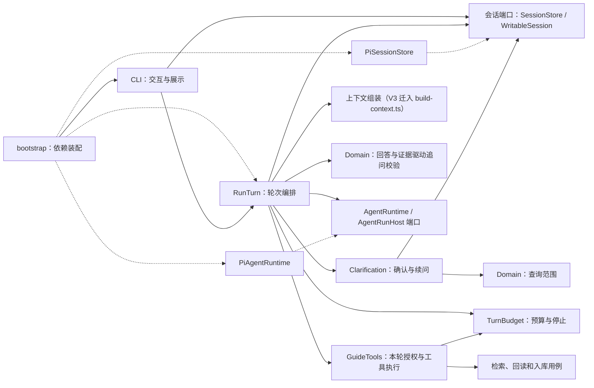

# TeyvatNotes 详细设计（SDD）

> 本文定义 Pi Agent 重做版的实现契约，不代表功能已经交付。产品范围与验收以[需求文档](requirements.md)为准，技术边界以[架构文档](architecture.md)为准。接口字段和初始参数是新版实现约定。

## 1. 模块与交付边界

项目以 TypeScript / Node.js 编写，由 Docker Compose 在单台主机部署。用户从主机终端运行容器内的 `teyvatnotes` CLI。V1 交付受限 Agent Loop 和持久会话；V2 加入 PostgreSQL、ChromaDB 和 Ollama，验收角色配队、混合检索与联网补充；V3 加入 Redis 和上下文压缩；V4 接入 Skills 与可信扩展；V5 按需确定增强项。新版不依赖旧桌面或 FastAPI 服务。已有术语、攻略样本和测试案例可作为实现输入；旧数据迁移另行确定。

V1 以受控模型通过真实 CLI 和 Pi SDK 验收，不要求接入真实模型、真实攻略或 V2 数据服务。V2 首批只交付通用配队和按已确认库存配队，以标准角色为首批真实验收范围，不要求明确版本的正式资料；版本规则仍回归验证。培养、配装、任务与解谜、机制问答留待后续排期。[需求 §2](requirements.md#2-项目概述)

| 模块 | 责任与依赖边界 |
| --- | --- |
| CLI 与装配入口 | 解析本地命令、管理会话、展示工具活动与已校验结果。按阶段装配依赖，不负责业务判断。 |
| 问答用例 | 管理范围、轮次、预算、工具授权与证据。依赖运行时、会话、攻略检索、资料源和入库等接口。 |
| 领域规则 | 处理标准名、适用范围、RRF 排序和引用校验。不依赖 Pi SDK、数据库或 HTTP。 |
| Pi 接入层 | 配置模型、资源和工具，通过 Pi SDK 启动对话并转发事件。工具通过应用用例执行，不直接访问存储。 |
| 数据与服务适配器 | 分别接入 PostgreSQL、ChromaDB、本机 Ollama、BWIKI 原生 MediaWiki API 和 Redis。可在测试中替换为受控实现。 |

### 1.1 关键文件职责

文件名以[架构 §2.1 的模块目录](architecture.md#21-项目模块级目录结构)为基线，是新版的实现约定，并非现有文件清单。只列跨模块衔接或承载关键规则的文件；辅助函数与模块内实现随开发确定。V1 只实现 CLI、闭环、权限和会话所需部分；V2 再接攻略检索与联网，V3 再加上下文压缩和 Redis，V4 再启用受控扩展。

| 关键文件                                                                                                                   | 职责                                                                                                                     |
| ---------------------------------------------------------------------------------------------------------------------- | ---------------------------------------------------------------------------------------------------------------------- |
| `package.json`、`tsconfig.json`                                                                                         | 分别声明依赖及编译后的 CLI 入口、定义 TypeScript 构建边界。                                                                                 |
| `Dockerfile`、`compose.yaml`                                                                                            | 分别定义 CLI 镜像和同主机的服务编排、网络、卷与运行时配置（§8）。                                                                                   |
| `src/bootstrap/main.ts`                                                                                                | `teyvatnotes` 的程序入口。按阶段装配用例及具体适配器，注入依赖后运行 CLI；V1 可注入受控模型与工具，不要求 V2 服务可用。                                               |
| `src/bootstrap/config.ts`                                                                                              | 读取、校验运行配置及凭据引用，把最小配置传给相应适配器；用户看历史时不以模型、数据库或 Redis 联通为前置条件。                                                             |
| `src/cli/runner.ts`                                                                                                    | 处理终端输入、会话命令和取消，向应用传递补充、确认或放弃的操作，展示应用返回的追问、进度和已提交结果；不维护追问的业务状态，不处理候选授权或直接读写底层服务。                                        |
| `src/application/run-turn.ts`                                                                                          | 问答轮次编排入口。接收 CLI 的问题或追问操作，调用追问用例和范围规则；条件齐全后冻结范围、创建轮次和预算、调用 Agent 运行时，接收校验结果后提交终态（§2.1～§2.3）。                            |
| `src/application/clarification.ts`                                                                                     | V2 追问用例。维护追问与原问题的关联，处理补充、确认、放弃、切换和恢复；调用范围规则判定缺项，经会话端口追加确认与追问进展。向调用方返回待确认事项或可继续的输入，不反向调用轮次入口，不调用模型或执行工具（§2.1）。          |
| `src/application/turn-budget.ts`                                                                                       | 维护同一轮的额度、请求窗口检查与停止信号；模型、工具、候选发现、正文读取和压缩按 §7 分别检查或计数。                                                                   |
| `src/application/guide-tools.ts`                                                                                       | 定义三个攻略工具的业务契约和执行器。持有本轮批次授权状态、候选登记簿和证据登记簿；调用检索或资料源用例执行获准操作，只有完整合法回读才登记证据，向答复校验提供只读视图（§3、§3.1）。向 Pi SDK 注册工具的动作在 Pi 适配器。 |
| `src/application/retrieve-guides.ts`                                                                                   | 调度两路召回、续取、过滤与融合，区分 `hit`、`miss`、未查完和依赖故障；回读只使用已授权候选（§4.3）。                                                             |
| `src/application/ingest-guide.ts`                                                                                      | 手工导入与联网补充共用的用例；校验材料、去重、分块、写索引并核对可查询性，再按各自规则发布（§4.2）。                                                                   |
| `src/application/build-context.ts`                                                                                     | 组装每次请求的上下文；V3 加入裁剪、摘要复用、Pi 压缩与缓存回退，缓存不能授予工具或引用权限（§6）。                                                                  |
| `src/application/ports/agent.ts`                                                                                       | 定义 `AgentRuntime`、模型请求门禁、工具批次和结果回送的应用契约，不暴露 Pi SDK 类型。                                                                 |
| `src/application/ports/session.ts`                                                                                     | 定义会话读写、轮次提交，以及追问和确认记录所需的读写契约；不负责字段归属或追问状态转换。                                                                           |
| `src/application/ports/guide-data.ts`、`src/application/ports/guide-source.ts`、`src/application/ports/context-cache.ts` | 定义攻略存储、向量索引、Embedding、联网资料源和派生缓存接口；存储行、供应商响应及 Redis 键格式不跨越该边界。                                                         |
| `src/domain/query-scope.ts`                                                                                            | 定义 `QueryScope` 和纯范围规则：角色标准化、版本和目标限定、确认条件的适用性，以及必填条件缺项判定。输入和术语表由上层传入；不管理追问状态或读写会话。                                     |
| `src/domain/guide-ranking.ts`                                                                                          | 提供纯 RRF 排序规则，不发起检索。                                                                                                    |
| `src/domain/answer-validation.ts`                                                                                      | 校验答复结构、显式库存条件、证据 ID 和冲突条目；只读应用提供的本轮范围与已获授权证据，不发起检索或回读，也不提交结果。                                                          |
| `src/adapters/pi/runtime.ts`                                                                                           | 实现 `AgentRuntime`。Pi 会话初始化、SDK 消息和事件转换、模型传输、工具注册、批次分派、按调用 ID 回送结果及取消传播都在此文件内处理（§2.2）；不决定攻略工具权限、证据资格或答复是否有效。            |
| `src/adapters/pi/session-store.ts`                                                                                     | 用 Pi 的本地记录实现会话端口，处理跨进程写锁、追问与确认记录的追加和读回、轮次提交、只读快照及中断恢复（§2.3）；追问业务状态由应用用例重建。                                             |
| `tests/integration/pi-runtime.test.ts`                                                                                 | 回归 Pi 适配时序：多工具批次、调用 ID 配对、拒绝结果、取消后的停止及不重复执行工具（§9）。                                                                     |
| `src/adapters/postgres/guide-repository.ts`                                                                            | 保存攻略版本、原文、分块和发布状态；实现关键词查询、分页和证据回读所需的数据访问。                                                                              |
| `src/adapters/chroma/vector-index.ts`、`src/adapters/ollama/embedder.ts`                                                | 分别实现向量索引及本地 Embedding 端口。向量化、检索和入库流程由应用组织，两者不互调。                                                                       |
| `src/adapters/web/bwiki-source.ts`、`src/adapters/web/metadata-parser.ts`                                               | 前者实现 BWIKI 原生候选发现、来源约束与指定修订章节读取；后者按来源规则从原文提取带位置的元数据。最终校验和发布由入库用例负责（§5）。                                                |
| `src/adapters/redis/context-cache.ts`                                                                                  | V3 实现带 TTL 的派生缓存；向调用方区分有效命中、缓存未命中和缓存不可用，应用决定如何重建。                                                                      |

**V2 轮次编排边界（FR-002、FR-003、FR-006）**：`RunTurn` 串联「确认条件并冻结范围 → 在预算内运行 Agent → 校验答复 → 提交终态」。范围规则见 §2.1；工具分派、批次授权及证据登记见 §3 和 §3.1；答复校验见 §3.2。候选授权与引用资格分别维护：候选允许回读，只有完整合法回读才生成可引用证据。答复校验只读本轮证据，不补做检索或回读。这是职责划分，不要求每项职责单独新建文件或类。

### 1.2 模块间依赖边界

| 模块 | 允许依赖 | 禁止依赖或跨越的职责 |
| --- | --- | --- |
| `bootstrap` | CLI、应用、端口和具体适配器，用于装配 | 不承载配队、授权、发布或引用规则；其他层不反向引用它。 |
| `cli` | 应用公开用例和输入输出契约 | 不直接引用 Pi SDK、数据库、网络适配器或 `bootstrap`；不自行推断追问状态、合并已确认条件或展示未提交的模型草稿。 |
| `application` | `domain`、本层用例和 `application/ports` | 不从 `adapters` 导入实现，不使用供应商或数据库专有类型，不绕过端口进行 I/O。 |
| `domain` | 领域内部的类型与纯规则 | 不依赖应用、CLI、适配器、文件系统、网络和数据库，不读取运行环境。 |
| `adapters` | 对应端口、领域值类型、必要的外部 SDK 或客户端 | 不导入应用用例、不互相调用；跨适配器协调由应用负责。Pi 工具只经注入的回调执行，不直接写攻略库。 |

运行时凭据只进入需要它的适配器。术语资源、V4 Skills 与扩展由装配层按阶段加载，不能改变应用的工具白名单。测试替身实现相同端口；单元测试不依赖真实 SDK 或服务，集成测试覆盖适配器契约，CLI／Compose 验收走正式入口（NFR-005、AT-02、AT-11）。

### 1.3 关键接口的 TypeScript 签名

以下只固定应用入口和关键端口。类型名引用后文的语义约定，不展开所有字段；这些是项目自己的接口，不是 Pi SDK 的方法签名。

```ts
// src/application/run-turn.ts
declare function runTurn(
  session: WritableSession, input: TurnInput, signal: AbortSignal,
): Promise<CommittedTurn>;

// src/application/ports/session.ts
interface SessionStore {
  create(): Promise<WritableSession>;
  open(sessionId: string): Promise<SessionOpenResult>;
  readHistory(sessionId: string): Promise<ReadonlyHistory>;
}

interface WritableSession {
  appendConfirmedConditions(change: ConfirmedConditionUpdate): Promise<void>;
  commit(result: VerifiedTurn): Promise<CommittedTurn>;
  close(): Promise<void>;
}

// src/application/ports/agent.ts
interface AgentRuntime {
  run(input: AgentRunInput, host: AgentRunHost, signal: AbortSignal): Promise<AgentRunResult>;
}

interface AgentRunHost {
  prepareModelRequest(draft: ModelRequestDraft): Promise<PreparedModelRequest>;
  executeToolBatch(batch: ToolBatch): Promise<readonly ToolResult[]>;
}
```

`SessionOpenResult` 区分已获写锁的 `WritableSession` 和 `SESSION_BUSY` 下的只读历史；只读模式不能调用 `runTurn`。`runTurn` 仅在 §2.3 的提交完成后返回 `CommittedTurn`，持久化失败则报告错误，不返回已完成答复。Pi 适配器在实际模型请求前经由 `prepareModelRequest` 接受应用检查，并将同一批工具调用一起交给 `executeToolBatch`；回调保留调用标识，取消、预算耗尽或授权拒绝按 §2.2 与 §3.1 处理。

```ts
// src/application/retrieve-guides.ts
declare function searchGuides(
  scope: QueryScope, query: string, limits: RetrievalLimits, signal: AbortSignal,
): Promise<GuideSearchOutcome>;

declare function readGuide(
  scope: QueryScope, candidate: AuthorizedCandidate, signal: AbortSignal,
): Promise<GuideReadOutcome>;

// src/application/ports/guide-source.ts
interface GuideSource {
  search(query: GuideSearchQuery, requests: SourceRequestBudget): Promise<SourceSearchOutcome>;
  fetch(candidate: SourceCandidate, requests: SourceRequestBudget): Promise<SourceFetchOutcome>;
}

interface SourceRequestBudget {
  // 由应用在每次实际请求前检查、扣额，并下发该请求的超时与取消信号
  begin(operation: "discover" | "read"): AbortSignal;
}
```

`GuideSearchOutcome` 必须区分正常命中、正常未命中和检索失败；未查完不能折算成 `miss`。`AuthorizedCandidate` 由应用根据当前批次快照创建，模型只能提交候选 ID。`GuideSource.fetch` 只接收本次发现且经应用许可校验的候选；适配器仍须在每次出站前执行 §5.1 的来源检查。`begin` 在预算不足或取消时抛出相应的轮次终止错误，不发请求；一次 `fetch` 中的两次 Parse 必须分别调用 `begin`。

## 2. CLI 与轮次执行

本章定义轮次相关模块的目标协作方式，对应 FR-001 至 FR-004、FR-006、FR-007。现有 V1 受控测试继续走同一 CLI、轮次入口和 Pi 运行时端口。V2 攻略工具和领域答复校验随对应功能接入，V3 再迁出完整的上下文组装与压缩策略。

### 2.1 输入、条件和会话

- `docker compose run --rm teyvatnotes` 启动交互模式。CLI 通过会话端口处理 `/new`、`/open <会话 ID>`、`/history` 和 `/exit`，这些命令在本地完成。空白输入不创建轮次；运行中 `Ctrl+C` 取消本轮。同一会话跨 CLI 进程只允许一个写入者（§2.3），V1 不排队追加输入。
- V2 提供 `teyvatnotes guides import <文件> [--publish]` 和 `teyvatnotes guides publish <文档版本 ID>`。手工导入默认保留待发布状态；发布与联网自动入库复用同一套索引就绪检查。
- 应用结合本轮输入、已确认的会话条件和专名词表解析角色、游戏版本、攻略类型和目标。明确的新条件覆盖旧值；歧义或冲突先追问。不能根据文档日期或模型猜测补游戏版本，也不从模型建议自动登记角色别名。
- 按库存事实解析角色或装备的持有、未持有，以及仅本轮不使用。明确的声明可与问题写在同一句，不依赖逗号、换行等分隔符；疑问、否定范围不清、实体无法唯一识别或前后冲突时，不能丢弃限制继续答，也不能记为已确认事实，应追问澄清。
- V2 的 `guideKind` 为角色配队。两种模式均需标准角色、目标和授权版本层；库存是答复约束，不是检索前置条件。
- 持有信息区分 `unknown` 和明确空清单；未提及不等于明确未持有。确需确认库存时不能挡住可展示的原文参考。
- 未持有目标、明确空清单或本轮排除继续作为冻结约束，不提前结束轮次。在 §3.2 解释冲突，而不是隐藏有证据的参考阵容。
- 条件齐全后冻结本轮 `QueryScope`：`scopeId`、`versionScope`、`entityId`、`guideKind`、`goal`、`teamMode`、`playerConstraints`。`scopeId` 由应用管理，工具仅接收检索词或候选 ID；不能通过工具参数扩大范围。

| 会话条件类别 | 新轮次如何派生 |
| --- | --- |
| 同一玩家的全局库存 | 跨角色、版本、目标保留已确认的持有与不持有记录，保留明确空清单；用户确认修改后才更新。 |
| 角色、版本或目标约束 | 按所属角色、适用版本和目标选择。换角色不套用上一角色的命座、限定武器；换版本不带入旧版本前提；换目标只保留仍适用的事实，缺必需条件再问。 |
| 任务进度（后续阶段） | 绑定任务和适用版本；切换任务、版本或出现进度冲突时先确认，V2 不提供任务问答。 |
| 历史证据 | 保留原记录可供查看；新轮次创建新的候选和证据登记簿，重新检索、回读且不继承旧轮授权。 |

**V2 追问状态（FR-001、FR-004、FR-006）**：`src/application/clarification.ts` 维护待补充状态，关联会话、原问题所在轮次、当前已知的角色／版本／目标及仍待确认的字段。基本查询条件齐全后才构造 `QueryScope`，回读后发现的必要装备等条件按 §2.2.3 处理。状态从会话中已提交的追问、确认和后续处理记录恢复，不能只看最后一轮的终态。CLI 收集输入、展示待确认内容并转交操作，不自行判定字段归属或合并条件。

- **补充与确认**：补充草稿不作为事实；收到明确确认后，应用先按原问题核对适用范围、追加条件确认记录，再决定是否继续追问。条件齐全后开启新轮次，重新建立范围、预算和工具权限。
- **放弃或切换问题**：用户明确放弃当前追问，或明确提出不同问题时，不把新输入当作旧问题的确认。放弃时丢弃未确认草稿；切换时只按上表继承仍适用的已确认条件，不带入旧问题的候选或证据权限。意图不明确时先澄清。
- **失败、取消运行与恢复**：补充尚未写入时不生效，恢复待确认事项；已写入则保留，不因后续失败或取消而重新询问仍有效的字段。原问题尚未解决且未被用户放弃时，可显式继续；仍缺的条件继续追问，已补齐则新开一轮。原历史和已提交终态不改写，也不自动重发失败调用。

#### 2.1.1 版本查询与确认

按 [FR-006](requirements.md#fr-006-工具驱动的攻略问答与引用) 区分查询意图和资料所声明的适用版本：

| `versionScope` | 进入条件与检索顺序 |
| --- | --- |
| `exact` | 用户指定了版本，或同一问题仍有适用的已确认会话版本。只检索明确覆盖目标版本的攻略，`null` 不算命中。 |
| `latest` | 用户明确问「最新」，或未提供版本且没有仍适用的已确认版本。若有可信且已核实的当前游戏版本，先检索明确覆盖该版本的攻略，正常未命中才查 `null`。没有已核实的当前版本则直接查 `null`，不从日期、Wiki 修订、模型或库中最大版本猜测。 |
| `unknown_reference` | 指定版本正常查不到匹配攻略、且用户明确接受未知版本参考后才进入。保留原请求版本；新轮先复查指定版本，仍正常未命中才查 `null`。此确认轮只查库，不重复联网补查。 |

指定版本查询结束时，若确认没有匹配、且库里存在同角色、同类型并符合其他已确认条件的未知版本候选，应用返回 `needs_clarification`，询问「没找到适用于 {版本} 的攻略，是否查看版本未知的参考？」。确认前只核对候选是否存在，不把候选 ID 或正文交给 Pi，不展示配队建议。拒绝则报告资料不足；含混回复不视为同意。检索未完成、依赖故障或命中后回读截断不触发此问句，也不降级查 `null`。

`clarification.ts` 复用现有追问记录处理该确认，绑定原问题及冻结的角色、版本、目标和条件。确认后新建轮次、预算及候选／证据登记簿；不把同意写为全局偏好，不沿用至其他问题或已改变的范围。CLI 只收集确认并展示结果。

### 2.2 Pi 接入、停止与恢复

#### 2.2.1 应用层编排与依赖方向

`RunTurn` 采用**用例编排**：由它决定一个问答轮次何时开始、调用哪些协作者、何时停止及如何提交。工具、上下文和校验模块各自完成子流程。`PiAgentRuntime` 实现运行时端口，负责轮次内部的模型与工具循环，模型根据已经收到的工具结果选择下一步。`RunTurn` 通过端口和回调控制该循环的业务边界，模型请求的顺序及 SDK 消息处理由 Pi 管理。



实线表示调用或依赖方向，虚线表示装配或端口接入。`bootstrap` 注入具体实现，CLI 依赖用例和会话端口，应用依赖领域规则和应用端口。Pi 适配器只通过 `AgentRunHost` 回调与应用交换请求检查和工具批次。领域层定义证据契约，使用值类型和只读数据执行校验。

| 模块 | 负责的决定与状态 |
| --- | --- |
| CLI | 处理终端命令和 `Ctrl+C`，向应用传入输入、取消信号及进度回调，展示追问提示和已提交结果。 |
| `RunTurn` | 协调追问预检、轮次初始化、运行时调用、校验和提交。统一映射异常和终态，记录诊断并清理轮次资源。 |
| `Clarification` 和 `query-scope.ts` | 前者管理原问题、补充确认和续问状态，经会话端口读写相关记录；后者用纯规则判断条件是否齐全、适用，生成可冻结的范围。 |
| `TurnBudget` | 维护单轮时限、请求窗口和调用额度，向模型和工具提供同一轮的停止信号及用量结算（§7）。 |
| `GuideTools` | 接收完整批次，集中授权和分派。持有本轮候选、证据、资料缺口和联网状态，调用检索、回读及入库用例，向校验方提供只读证据视图（§3）。 |
| `build-context.ts` | V3 接管历史与条件筛选、上下文组装、裁剪和压缩协作。接收范围及只读的历史和本轮证据，预算仍由 `TurnBudget` 记账（§6）。 |
| `answer-validation.ts` | 用纯规则检查模型草稿、范围、证据和显式持有条件。返回可提交的答复、资料缺口、证据驱动追问或稳定校验错误。 |
| Pi 适配层 | `PiAgentRuntime` 管理 SDK 会话和模型、工具交换。`PiSessionStore` 经会话端口提供落盘、只读快照与异常恢复（§2.3）。 |

上述划分描述职责，沿用 §1.1 中的模块规划。V2 工具接入时再抽出批次执行，接入正式答复校验时再迁移领域规则。历史筛选及上下文算法随 V3 落在 `build-context.ts`，在此之前保留最小上下文准备。受控测试从测试装配入口注入工具和模型，仍可在没有攻略范围及正式依赖的情况下运行 V1 轮次，不需要创建空的攻略模块来复用流程。

#### 2.2.2 轮次工具环境与批次交接

V2 在 `RunTurn` 中用注入的工厂为每个可执行攻略轮次创建一个 `GuideTools` 执行环境。输入为 `turnId`、应用冻结的只读 `QueryScope` 和同一轮的 `TurnBudget`。`QueryScope` 来自 §2.1 的确认流程；即使模型请求中带有范围文本，工具仍以应用传入的范围为准。本地工具参数只提供检索词或候选 ID，补查不接收参数。连接池、Embedding 客户端和无轮次状态的检索或入库用例可由装配层复用，每轮重新建立候选授权、证据登记、缺口和联网状态。

执行环境提供工具定义、`executeBatch(batch)` 和 `evidenceView()` 三项能力。`RunTurn` 将批次回调绑定到该环境，保留对模型预算、进度及终态的协调。Pi 适配器把同一条完整回复中的调用及协议拒绝一次性交给应用，并按原 `toolCallId` 回送结果；SDK 回调只读取已分派结果。SDK 类型、参数协议校验与调用配对由适配器处理，组合授权由 `GuideTools` 按 §3.1 统一处理，单个工具处理器只执行已经获准的操作并继续核对数据范围。

`GuideTools` 在任何分派前用完整批次和上一批已回送状态做判断。执行前原子占用联网资格和对应额度，拒绝项保留调用标识且无执行副作用。本批候选及查库状态先作为待回送结果登记，由 Pi 适配器经运行时端口确认结果已交给循环后，才对下一批授权生效。工具执行完成和结果回送是两个不同的时点。同批 `hit` 与 `miss` 按 §3.1 以命中锁定为准。只有本轮、同范围的完整合法回读才能进入可引用证据视图。证据视图以领域值类型表达，和工具执行器的可变登记簿分开。结束或取消时关闭授权，迟到的结果不能再更新本轮状态。Pi 升级时用 §9 的时序用例核对只分派一次、结果配对、回送边界和取消传播（AT-02、AT-03、AT-10）。

#### 2.2.3 执行顺序与终态

1. CLI 把非空输入交给 `RunTurn`。先由 `Clarification` 处理补充、确认、放弃或切换。只需交互提示时直接返回；需要记录轮次时，创建轮次与预算，追加开始记录，并在执行前写入本次明确确认的条件。已持久化的条件不依赖答复成功（§2.1、§2.3）。
2. 前置条件不足时提交 `needs_clarification`，模型和工具调用均为零。条件齐全时冻结范围，创建本轮工具环境，组装模型输入，再启动 `AgentRuntime`。V1 受控轮次采用其测试工具和最小上下文。查看已提交历史只走会话读取路径。
3. Pi 适配器使用 `createAgentSession()` 和 `SessionManager` 接入 SDK，会话、模型和白名单由装配配置提供，默认关闭通用编码工具及非受控资源。每次实际模型请求前，经应用检查取消信号、最终请求窗口和剩余预算；模型有工具调用时走完整批次。工具执行与回送完成后，由 Pi 决定是否发起下一次模型请求。[Pi SDK](https://docs.pi.dev/latest/sdk)
4. `RunTurn` 将草稿、冻结范围、只读证据及工具确认的资料缺口传给领域校验。校验结果携带可提交内容或稳定错误。校验接受有依据的追问时，`RunTurn` 将结构化缺项交给 `Clarification`，关联原问题并建立待补充状态。补齐之后开启新轮次，重新冻结范围及授权。
5. `RunTurn` 确定终态，经 `WritableSession` 提交，再把结果返回给 CLI。取消、超时、额度耗尽和不可恢复错误关闭本轮权限，停止后续模型及工具调用。终态提交遵循 §2.3 的独立写入边界，运行取消不打断应完成的提交动作。退出时清理预算计时与运行时订阅，诊断按 §7 记录。

**追问与可用性提示（FR-006、AT-06）**：执行前追问用于明确基本查询条件或无法解释的限制。回读发现必要但未确认的前提时，按 §3.2 标注可用性；即使模型提出装备追问，也不得用它替代已有原文依据的参考阵容。伪造证据或无效结构走相应校验错误；无可引用证据走 `insufficient_evidence`；查询故障和预算终止按其自身原因结束。领域校验无 I/O，替代方案的检索与回读在工具循环中完成。

用户可见终态为 `answered`、`needs_clarification`、`insufficient_evidence`、`failed`、`cancelled`、`interrupted`。`failed` 带稳定错误码；`interrupted` 由会话恢复识别。恢复只重建已持久化的确认和结果，重开或切换会话需要重新绑定进度并建立新轮次的授权，旧请求不自动重发。

### 2.3 提交点、恢复与跨进程互斥

**提交点（FR-004、DR-001）**：Pi 原始消息、工具交换和模型草稿是运行记录，不是应用确认的答复。应用在持有会话写锁期间，为同一 `turnId` 追加一条 `turn_committed` 记录，包含终态、经校验的用户可见内容、应用生成的引用快照及关联的 Pi 条目标识，并确认写入持久化后才展示。引用快照保留来源、文档版本、分块位置和摘录；有依据的配队思路即使没有阵容，也与引用一并提交和恢复（§3.2）。其余非成功终态保存相应的已验证追问或错误，不拼接未校验的草稿。CLI 可展示运行进度，但不把未提交正文当作最终回答。写入失败不展示成功结果，不重发模型或工具请求。

**恢复**：按 `turnId` 识别完整可验证的提交记录，同一轮只认一条有效提交。原始 assistant 消息既不作为已提交答复，也不在新轮中当作已确认事实。若退出时尚无完整有效提交，获得写锁后的恢复流程识别该轮为 `interrupted`，已确认且已持久化的条件仍保留，旧调用不重放。若提交已落盘但尚未展示，重开时直接显示已提交结果，不重复写入、生成或回读。构建历史快照时忽略末尾未完成记录；发现损坏而无法安全追加时，保留旧记录并报告错误，不静默覆盖原历史。

**写入互斥与历史读取**：在同一主机的 Compose 会话卷内，按规范化会话 ID 使用同一持久锁文件，以非阻塞方式获取 OS 独占文件锁，不以进程内变量、Redis 或锁文件是否存在判定独占。应用先获取锁，再打开可写的 Pi 会话；Pi、应用追加写入及中断恢复都受该锁约束，关闭会话、关闭锁句柄前须完成写入。锁句柄不传给子进程，进程退出后由 OS 释放锁，不按超时抢占。[Linux `flock` 锁语义](https://man7.org/linux/man-pages/man2/flock.2.html)

写入者确认提交持久化后，以原子替换更新同卷的只读历史快照，快照可由原记录重建，不是另一份会话权威来源。锁由其他进程持有时，CLI 仅打开已发布快照并提示 `SESSION_BUSY`，不直接跟读仍在追加的日志；不展示未提交草稿，也不把仍运行的轮次标为中断。此模式拒绝提交问题、追加条件及恢复写入。若写入者在提交后、刷新快照前退出，下一位写入者获取锁并重读原记录以重建快照；不会因此再次生成答复。用户必须显式重新打开并成功取得锁后才进入写模式。

## 3. 工具与引用契约

| 工具 | 输入 | 返回与授权 |
| --- | --- | --- |
| `search_guides` | `query`：非空检索词 | `hit` 返回当前已授权版本层的 `candidateId`、标题、适用版本区间或 `null` 及简要摘录；仅所有允许查询的版本层均正常查完且无合格候选才返回 `miss`。未查完返回 `RETRIEVAL_INCOMPLETE`；依赖故障返回 `RETRIEVAL_UNAVAILABLE`。均不授予引用资格。 |
| `read_guide` | `candidateId`：本轮已回送的候选 | 应用核对候选、范围和版本，再从 PostgreSQL 读取原文窗口。成功完整回读才登记 `evidenceId`，并返回原文、位置和已有元数据。 |
| `search_web_guides` | 无参数（仅 `{}`） | 仅在 §3.1 的「可补查」状态且通过批次校验后执行；出站只用冻结范围的标准角色。区分 `indexed`、`no_results`、`source_restricted`、`no_readable_body`、`metadata_incomplete` 和故障；`indexed` 不授予引用资格。 |

统一工具结果包含原 `toolCallId`、`status` 和对应的数据或错误码。应用拒绝未知工具、重复 ID、无效参数、旧轮次候选及越界调用。模型不能提交任意网页地址、向量或存储过滤表达式作为工具参数。

### 3.1 轮次授权状态与批次校验

| 轮次状态 | `search_guides` | `read_guide` | `search_web_guides` | 状态转换 |
| --- | --- | --- | --- | --- |
| 待确认范围 | 禁用 | 禁用 | 禁用 | 条件齐全进入「待查库」；否则追问并结束本轮。 |
| 待查库 | 开放 | 禁用 | 禁用 | 查库结果回送后，`hit` 进入「已命中」，`miss` 进入「可补查」；§2.1.1 的确认参考轮不开放补查。 |
| 可补查 | 开放 | 禁用 | 仅限不含查库的批次，本轮最多执行一次 | 查库仍为 `miss` 则保持；任一正常 `hit` 进入「已命中」。执行合法联网调用前原子占用本轮联网资格，进入「已补查」。Pi 也可不调用并结束。 |
| 已命中 | 开放 | 仅限批次开始前已回送、且本轮同范围的候选 | 本轮永久禁用 | 后续换词返回 `miss` 也保持「已命中」；新的 `hit` 可在回送后增加候选。回读截断不改变状态，也不授予引用资格。 |
| 已补查 | 开放 | 仅限补查后重新查库命中、且在批次开始前已回送的候选 | 本轮永久禁用 | `indexed` 后按原问题和范围重检，候选回送后再回读。无结果、无获准来源、缺正文或元数据、重检仍未命中时说明缺口。查库再命中也不重置联网额度。 |
| 已结束 | 禁用 | 禁用 | 禁用 | 成功、追问、资料不足、取消、超时、预算耗尽或不可恢复错误关闭全部权限；查库故障返回检索错误，不产生 `miss`。 |

**一批**是模型同一条回复提出的所有工具调用。执行器在批次开始时冻结授权快照，只采用上一批完成回送时已提交的查库状态与候选授权。当前批结果不论按何种顺序返回，均不能为同批新增权限；候选和查库结果回送后，才可供下一批使用。同一批包含多次查库时，只要任一查库正常命中，下一批就必须锁定联网，不以最后一个返回的 `miss` 覆盖。取消、预算耗尽和已占用的联网资格可立即收紧权限。

`miss` 只来自两路都成功并确认查完、且按发布状态和范围过滤后无候选的查询；首批结果过滤为空不能据此开放联网（§4.3）。正常未命中且可补查时，结果给出下一步工具名；应用仍等本批完整回送后才开放相应权限。未查完或任一路依赖故障均结束为检索未完成或失败，本轮不获得联网授权；先前已回送的 `miss` 也不能再用于补查。查库已命中但正文回读截断时，保留命中锁与现有合格候选，不给截断窗口授权；没有其他完整证据则报告资料不足。[FR-005 联网判定](requirements.md#fr-005-攻略导入混合检索与联网补充)

- 同批发出查库和回读，只允许回读快照中已授权的候选。因本批查库才出现的候选，即使执行回读时已经算出结果，也返回 `CANDIDATE_NOT_AUTHORIZED`，不读取正文。
- 同批包含查库和联网时，拒绝联网调用，即使上一批已经正常未命中。令 Pi 先收到查库结果，再在下一批单独决定是否调用联网。其他未满足状态、白名单、批次或单轮次数限制的调用同样返回 `TOOL_NOT_ALLOWED`，不发送外部请求或写入数据。拒绝结果保留原 `toolCallId`，不撤销同批其他合法且独立的调用。

### 3.2 回答结构

模型提出 `GuideAnswerDraft`。顶层必须有数组 `recommendations`、`gaps`，可附数组 `observations`。有配队思路或阵容时，`observations` 和 `recommendations` 至少一项非空，且 `gaps` 为空；无可用证据或存在未解决冲突时，两类建议都为空且 `gaps` 恰有一项。仅接收 JSON 对象，不为补齐阵容另发模型请求。

| 字段 | 含义与验证 |
| --- | --- |
| `team` | 恰有四个槽位，每个槽位包含 `characterId` 和 `equipmentIds`。角色经词表校对后四人互异，且包含目标角色；数组中的装备是该槽位实际建议使用的武器或圣遗物，不是示例清单。同一槽位不得同时指定多把武器。未建议装备时写空数组；空数组不证明攻略没有装备前提。 |
| `evidenceIds` | 非空，只能引用本轮成功完整回读的证据。应用验证轮次、冻结范围、已授权版本层及引用定位；不检查四名角色是否在原文中同时出现，也不依赖原文识别整队或实际建议装备。 |
| 证据中的适用前提 | 来自回读证据的 `conditions`、`requiredCharacterIds`、`requiredEquipmentIds`，由程序读取并校验，不再要求模型把证据前提复述为 `requiredEntityIds`。它们与 `team` 中实际使用的实体分别检查；模型不能靠省略显式前提绕过校验。 |

**配队思路（FR-006、V2-P05）。** `observations` 每项含 `kind`（`teammate`、`role` 或 `restriction`）、`text`（模型用自己的话整理的一条建议或说明）、`evidenceId`、`excerpt`（支持该条的连续原文）。应用校验证据归属及摘录确实存在，正文只展示整理后的内容，原文由引用区展示；程序不把 `text` 当原文，不允许用它自行填链接、宣称玩家持有或标为可用。只有思路、没有整队时也按 `answered` 提交和恢复。

推荐区只由程序根据通过结构检查的槽位、装备和证据前提渲染。术语只认标准名或已审核别名；角色、装备类别不符或无法唯一解析时拒绝。模型生成的链接、搜索摘要、历史摘要和 Redis 内容都不能作为引用。结构或引用非法时拒绝，不自动重发。

按 FR-006 先展示有引用的配队思路，再展示可选的四人建议。应用将综合组合标为「模型整理」，不以同篇、同段或同一套原文阵容为显示门槛。库存模式只有在角色、装备及已知适用前提确认满足时才优先标为可用；明确缺项或排除时说明冲突，适用前提未知则提示，不隐藏有合法引用的建议。没有可用证据才显示资料不足；伪造、跨轮、错范围和截断引用仍拒绝。

**时效提示（FR-006）。** 通过校验的引用保留真实游戏适用版本；`null` 显示「版本未知」，不以查询版本回填。应用从最终实际使用的引用生成提示；正文与引用之后仅追加一次「该攻略版本未知，请注意时效性」。仅检索或回读、最终未引用时不加。提示与答复一并提交，历史恢复不重复追加；不依赖模型生成提示，也不因此放宽引用或库存校验。

**装备前提与库存（FR-006）**。原文中未知的配队前提不能视为无额外限制；未知版本仅能按 §2.1.1 作带提示的参考，这两类情况都不等于未知持有状态。通用配队可写「若持有装备 E，可使用此组合」，同时引用说明 E 为必要条件的原文；不能声称玩家已有 E 或忽略明确的不可用约束。

回读发现未确认的必要装备时，优先寻找符合库存的替代。确有必要可提示用户确认，但不得以追问替代可展示的原文方案；已知缺少或排除不重复追问。新的确认开启新轮并重新回读，不继承证据授权。

**冲突条目（V2-N04）**。同范围的已回读材料存在无法消解的冲突时，使用 `gaps[]` 中的 `kind: "conflict"` 条目；`sides` 恰有两项，每项分别提交非空 `conclusion`（该资料的结论）、`conditions`（该结论的适用前提，可在有依据的无额外限制时为空）和非空 `evidenceIds`。应用对两方逐项检查 ID 在本轮证据登记簿中、匹配同一 `turnId` 和 `scopeId`、所指文档版本适用且窗口回读完整；两方须各有可区分的证据，不能用同一段原文冒充双方。遇未知、跨轮、跨域、截断或伪造引用时，以 `INVALID_CITATION` 拒绝整个冲突条目，不能只保留一方当作正确结论；模型提供的 URL 不用于定位。成功校验后并列展示双方结论、各自前提和应用生成的原文位置，说明分歧，不输出唯一确定建议；RRF 名次不是对错依据。验收将「双方原文可定位」与「原文分别支持对应结论和前提」分开判定。

## 4. 攻略存储、发布与检索

### 4.1 数据模型

| 存储记录 | 关键字段与约束 |
| --- | --- |
| PostgreSQL `guide_source` | 来源 ID、规范化原文链接、标题及来源类型；联网导入关联来源许可配置，保留作品原出处。搜索供应商不替代原来源。 |
| PostgreSQL `guide_version` | 版本 ID、来源 ID、规范正文及哈希、处理版本、游戏适用版本、目标标准实体、攻略类型、适用条件和发布状态。适用条件区分 `known`、有原文依据的 `unrestricted` 和 `unknown`；获准的 BWIKI 正文可在 `unknown` 时发布，手工导入规则不变。游戏适用版本为已验证的闭区间，或整体为 `null`；起止版本及排序键须同时有值或同时为 SQL `NULL`。游戏适用版本参与 `content_hash`，保留按 `(source_id, content_hash, processing_version)` 去重；补齐依据不覆写历史引用。Wiki 修订与游戏版本分别记录，联网元数据保留依据位置或未知原因（§5.2）。 |
| PostgreSQL `guide_chunk` | 分块 ID、文档版本、文内顺序、章节路径、正文、原文位置和规范术语。旧版本的正文及引用位置保持可定位。 |
| PostgreSQL 索引检查点 | 文档版本、Embedding 配置 ID、预期分块和索引就绪状态。索引未就绪的资料不进入检索结果。 |
| ChromaDB | 分块 ID、向量、粗筛元数据。按 Embedding 配置隔离集合；原文、发布状态和引用以 PostgreSQL 为准。 |

### 4.2 导入和发布顺序

1. 将 Markdown、JSON 或授权来源正文转成统一输入，规范化来源、正文和已有元数据。联网自动发布按 FR-005 和 §5.2 校验最低证据；不以四人名单或适用条件为必填。对合格的正文按章节、段落、列表和表格边界分块，保留可读的队友、位置与条件段落，不只索引完整阵容所在行，也不把独立页签或栏位拼为一套阵容。手工导入的校验与显式发布规则不变。
2. 在 PostgreSQL 短事务内保存合格版本、分块和检查点，初始为 `pending`；结构错误为 `invalid`。已获许可且正文可读、但最低元数据缺失或歧义时，按 §5.2 保存待补全记录并返回 `metadata_incomplete`；不进入索引写入、检索、发布或引用。用唯一约束复用重复导入；内容变化新建版本。已经就绪的同配置索引无需重新生成向量。
3. 提交事务后，将分块交给本机 Ollama 的 `POST /api/embed`，再按稳定分块 ID 幂等写入 ChromaDB。核对向量数量、维度和预期分块的可查询性。部分写入不发布；再次显式导入或维护重建复用已有身份，不重放原失败轮次。[Ollama Embedding 接口](https://docs.ollama.com/api/embed)
4. 在第二个 PostgreSQL 短事务内核对来源许可、最低元数据和索引可见性，再更新状态。三项均合格的联网资料自动标记 `published`，不增加人工内容审核；手工稿等待显式发布。索引失败报告 `INDEX_NOT_READY` 或对应故障，保持不可检索。发布只让候选可被检索，本轮仍须完整重检和回读才能授权引用。访问外网、调用 Ollama 和写 ChromaDB 时不持有 PostgreSQL 事务。

### 4.3 关键词、向量和 RRF

- **可安全前置的过滤**：使用权威发布状态、索引就绪、目标实体、攻略类型和授权版本层。已知版本按闭区间，未知层只匹配 `IS NULL`；库存和适用前提不决定候选资格。
- **版本层顺序**：按 §2.1.1 在同一查库预算内依次检查两路。只有优先层两路正常查完且都无合格候选，才查允许的下一层；超时、未查完或依赖失败立即按对应错误结束。RRF 只在同一层内融合，未知版本不参与精确命中的排序；本轮一旦命中，不因换词或回读失败转往较低层。
- **关键词续取**：用 PostgreSQL 按已确认别名、标准专名和检索词排序。使用可重复的排序键和分块 ID 游标继续读取，而不是只检查首批。底层正常返回游标到尾且范围一致，才可记为该路已查完。
- **向量续取**：本机 Ollama 对查询向量化；同一次查询沿用同一向量、Embedding 配置与 Chroma 集合。没有足够合格候选时，在本次查库预算内增大 Chroma `nResults`（如从 20 扩到 40），按分块 ID 去重，不能把重复请求误当向量游标或把重复结果计为已覆盖新分块。没有候选时，只有可核对覆盖才可判已查完：以 PostgreSQL 同范围、已发布且索引就绪的分块清单为依据；必要时分批按 ID 从 Chroma 取出排名查找未覆盖的向量，按相同距离规则补判。检查当前范围和索引版本仍与清单一致；清单为空且依赖检查成功才可直接判该路为空。没有可核对的覆盖时，短响应、空取页或近邻排名结果本身不证明已穷尽。[Chroma Query 与 Get](https://docs.trychroma.com/docs/querying-collections/query-and-get)
- **融合与结束**：以 PostgreSQL 最新发布状态、实体、版本、攻略类型和索引就绪状态校验候选。每路按分块 ID 去重，对各路的 1 起始名次计算 `1 / (k + rank)`，按分块 ID 合计；缺席通道贡献为零。按合计分排序，平分用稳定分块 ID 决断。RRF 即 V2 的重排实现。每路首批 20 条、合并后返回 8 条、`k = 60` 为初始评测参数，不是穷尽判据。续取受单次查库页数、累计候选数和剩余时限约束。两路无故障且已找到合格候选时可以返回 `hit`；无合格候选时，两路均确认查完才返回 `miss`。到达续取上限、范围快照变化或无法确认覆盖时返回 `RETRIEVAL_INCOMPLETE`；依赖失败或应有分块的索引缺失返回 `RETRIEVAL_UNAVAILABLE`。两种均不得触发补查。[RRF 原论文](https://cormack.uwaterloo.ca/cormack/cormacksigir09-rrf.pdf)
- **回读**：仅将排序后的合格候选回送 Pi；对候选的回读授权仍由 §3.1 的下一批规则决定。回读时重新核对范围并从 PostgreSQL 取得完整证据窗口。

## 5. BWIKI 联网资料源

### 5.1 搜索、来源许可与重定向边界

`search_web_guides` 的检索词由 Pi 提出。应用只接受与标准角色、查询版本范围和配队目标有关的普通检索词，拒绝 URL、`site:` 等过滤或布尔操作（`INVALID_TOOL_ARGUMENT`）。适配器从已确认角色构造 BWIKI 页面标题检索词，版本及玩家条件仍由应用在本地校验。对外不发送会话历史、库存、系统提示、模型密钥或用户原句。

出站固定向原神分站 `https://wiki.biligame.com/ys/api.php` 发送 GET，以标准查询参数编码并指定 `format=json`；`/wiki/api.php` 是站务文档入口，不用于读取游戏数据。许可配置记录获准 API、页面路径、许可依据及自动检索、读取、存储和引用的范围。无有效许可则返回 `source_restricted`，不出站。对候选规范化 URL，核对 HTTPS、域名、路径和标题一致性；正文读取只使用校验后的标题或修订参数，不把候选 URL 当请求地址。禁止私网目标、跟随重定向、登录、发送 Cookie、绕过站点控制或另行抓取 HTML。

1. **发现候选。** 请求 `action=opensearch`，仅使用返回的标题和链接建立候选；摘要不作为证据。仅当预期结构的成功响应返回空列表时记为 `no_results`；候选全部不在许可范围则记为 `source_restricted`。
2. **确定修订和章节。** 仅对获准候选用 `action=parse`、`page=<标题>`、`prop=wikitext|sections|revid` 获取修订号和章节目录。这次响应只用于定位，不能直接当作本轮引用。依据实际章节标题选择配队章节，记录 API 返回的 `index`；不写死页名、修订号或章节序号。
3. **读取固定修订的正文。** 再用 `action=parse`、`oldid=<修订号>`、`section=<index>`、`prop=wikitext|revid` 取得对应章节，校验返回修订及其与所选章节的对应关系。保留获准的原文链接、修订号、章节位置和正文。HTTP 567（曾返回 HTML，原因未确认）、其他非成功响应、跳转、非预期 JSON、API 错误或无法确认的响应对应关系统一记为 `WEB_SOURCE_UNAVAILABLE`，不当作无结果、不重试、不切换来源。成功响应确实没有可用章节正文时记为 `no_readable_body`。
4. **校验后入库。** 按 §5.2、§4.2 发布。`indexed` 表示同范围内可重检，库存与适用条件不否决重检。指定版本轮不以 `null` 代替精确匹配；最新查询仍按授权版本层优先。只有重检命中、完整回读才可引用。

单轮只执行一次补查：至多一次 OpenSearch、检查最多三个获准候选，默认至多发出三次 Parse。每次 Parse（包括修订／章节定位）分别扣读取额度，并受 §7 的超时和取消约束；预算用尽不追加请求、不发布未完成的资料。请求失败也计数，不把两个 Parse 合并记成一次。[MediaWiki OpenSearch](https://www.mediawiki.org/wiki/API:Opensearch) · [MediaWiki Parse](https://www.mediawiki.org/wiki/API:Parsing_wikitext)

**接口验证范围。** 无登录、Cookie 或密钥的只读探测已验证候选发现和指定修订章节的读取。BWIKI 的 `sections` 字段变更须单独验证；读取成功不等于已发布、可引用或通过 AT-10。

### 5.2 从正文提取可追溯元数据

适配器按 FR-005 将可读、相关的 Wiki 源文规范化为统一入库输入，保留原文链接、许可依据、Wiki 修订 ID 和章节定位。解析规则按版本管理，只以可核对的文字、章节标题、表格单元格或前提段落作为依据；标题或摘要不代替配队正文，图片及未解析模板不作为证据。

| 字段 | 接受的原文依据 |
| --- | --- |
| 游戏适用版本 | 原文明示的适用版本字段或章节声明；没有明确声明时返回 `gameVersions: null` 并记录未知原因。检索词、Wiki 修订 ID、发布时间、更新时间和单纯提及版本均不能替代，明确声明冲突也不能靠改成 `null` 绕过。 |
| 目标标准实体 | 标题、目标字段或对应章节明确指向角色；用已审核词表解析成唯一标准角色 ID，歧义不靠相似度或模型猜测消除。 |
| 攻略类型 | 原文类别声明，或明确绑定该角色的「配队」等章节；不能仅用用户问题的分类回填。 |
| 可提取的阵容 | 非入库必填。有可核对的共同使用关系才记录完整阵容；否则保留对应的可读段落和独立备选，不补齐空槽，不跨页签合并。 |
| 适用条件 | 非入库必填。明确且可绑定的前提保留 `known` 以及适用场景、装备、命座等约束；只有原文明示无额外限制时标为 `unrestricted`。未写、无法绑定、无法完整提取或存在未消解分歧时标为 `unknown` 并保留可核对的原文及已有前提，不因此拒绝入库。局部前提不升级成全文前提。 |

提取结果保留字段值、该文档版本内的依据位置及短摘录。无可读正文返回 `no_readable_body`；正文可读但缺少可确认的角色或类型，或角色、类型、明确版本声明冲突时返回 `metadata_incomplete`，仅在许可允许时归档为不可检索的待补全记录。未提取出完整阵容或适用条件不触发该状态。游戏适用版本未知以 `null` 存储，不伪造字段；不得用查询范围或模型推断补齐。原文版本、处理版本、去重和历史引用追溯沿用 §4.1／§4.2。

## 6. 上下文、Redis 与扩展

### 6.1 数据归属与上下文组装

Pi 本地追加式会话是聊天历史与用户已确认条件的权威来源，Pi 负责历史压缩。应用负责确定范围、选择适用条件、组装上下文、检查预算、授权工具及校验引用。PostgreSQL 是攻略原文的权威来源；历史引用可查看，本轮引用资格只来自本轮同范围的完整合法回读，不能从历史、摘要或缓存恢复。对应 FR-004、FR-006、FR-007 与 DR-002。

1. **先解析范围和条件**。按 §2.1 选择同一玩家的全局库存及仍适用的角色、游戏版本和目标条件；待用户确认的推断不进入已确认约束。未知库存不拦截检索；已确认没有或空清单影响可用性，不影响原文参考。基本查询条件齐全后建立或沿用本轮冻结的 `QueryScope`。
2. **再组装模型输入**。组合系统约束、当前问题、已确认条件、相关且必要的近期历史、适用的历史摘要、相关 Skill（启用且可用时）与本轮工具交换和证据。历史摘要只提供背景，不覆盖用户明确确认的条件，不成为可引用证据。
3. **每次发送前重新检查**。首个问答请求及工具返回后的每个后续模型请求都按本轮范围重做检查：对齐已回送的工具调用与结果，校验本轮证据资格，并对最终载荷检查上下文窗口和剩余整轮预算（§7）。新增的大工具结果要重新纳入估算；不能沿用上一请求的通过判定。工具结果不能自行扩大范围或修改已确认条件。

### 6.2 先裁剪，再压缩

借鉴 dsh 的处理顺序，不引入 dsh 作为依赖。只缩减发给模型的上下文，不删除或覆写本地会话里的原始条目。[Pi 压缩参考](https://docs.pi.dev/latest/compaction)

1. **先裁剪非关键内容**：去掉重复的候选摘要、过长工具结果中的非关键部分和与本轮无关的历史。当前问题、已确认约束、本轮必要的完整原文证据及工具调用与结果的配对必须保留。裁剪工具载荷时保留对应标识与结果状态，不把未完成的调用视为已完成。裁剪后若已满足窗口，直接发起问答请求，不调用摘要模型。
2. **仍超窗口才压缩**：优先复用覆盖该段且仍适用的持久化 Pi 摘要；仍不够时才由 Pi 对早期历史做压缩。摘要只保留可追溯的背景，不代替结构化条件、业务事实或证据。压缩请求本身也要检查单次窗口和整轮剩余预算，并计入整轮模型次数、Token 和时限。
3. **关键内容仍放不下则停止**：如果去掉所有可省内容后，受保护内容与输出预留仍超窗口，结束本轮并说明上下文放不下，不发送超限请求，也不丢弃约束后继续回答。若需要压缩但整轮额度已不足，则按预算耗尽处理；两种终止都不自动重试。

### 6.3 Redis 派生上下文缓存（V3）

Redis 仅在 V3 接入，不是持久化历史或问答授权的来源。键由会话 ID、该派生内容所依据的活动历史位置和上下文配置版本组成。值只包含可重建的已确认条件、已有 Pi 摘要及其来源位置，设置可配置 TTL。历史变动（包括已确认库存变更或切换分支）或上下文规则变更后，位置或版本不匹配的旧缓存不得继续使用。[Redis 键过期](https://redis.io/docs/latest/commands/expire/)

缓存缺失、过期、读写超时或 Redis 停机时，在本轮剩余预算内从本地会话重建，优先使用已持久化且适用的 Pi 摘要。Redis 未命中本身不触发摘要请求；仍按 §6.2 判断是否需要压缩。缓存不得保存完整会话、模型密钥、工具许可或引用授权，默认不对公网开放。离线查看历史不依赖 Redis；重建不重放旧工具，也不把旧摘要中的引用 ID 加入本轮。

### 6.4 Skills 与插件（V4）

从受控目录加载 `SKILL.md`，检查格式、名称冲突和启用范围。模型按任务选择相关指导；可信插件需显式启用，可注册领域工具和事件监听器。所有工具仍走同一权限、参数和预算检查，Skill 指令不能直接授予权限。

## 7. 配置、预算与诊断

| 配置组 | 内容 |
| --- | --- |
| Pi 与回答模型 | 镜像内的 Node.js / Pi SDK 版本、模型供应商、模型 ID、Base URL、协议与凭据引用。正式问答用 `deepseek-flash` 的无状态 `POST /responses`，发送必要消息及工具交换，不依赖服务商会话 ID。 |
| 检索与入库 | PostgreSQL、ChromaDB 和 Ollama 的 Compose 服务地址、向量集合、Embedding 标签与维度、分块、候选上限和 RRF 参数；单次查库续取页数、扫描分块数与时限受控。 |
| 当前游戏版本 | 可选的、经核实的运行配置，仅供 `latest` 优先检索；未配置则按 §2.1.1 查 `null`。不是攻略默认版本，也不依赖新的外部接口。 |
| 联网来源 | BWIKI 许可依据、获准域名和页面路径、允许的操作及解析规则版本。出站限定原生 API，不跟随跳转，不需要独立的搜索密钥。 |
| 单次请求窗口 | 模型支持的上下文上限、部署侧有效窗口、输入 Token 估算与输出预留；压缩请求也校验自己的请求窗口。 |
| 会话与整轮执行 | 本地会话目录、模型和工具次数、候选发现与读取的独立请求额度、累计 Token、各类单步超时和总时限；V3 配置 Redis 地址、读写超时和 TTL。 |

**单次请求的窗口**：最终发出的系统提示、消息、工具定义、工具交换和原文证据均计入输入。用实际统计或保守估算校验 `输入 Token + 输出预留 ≤ 本次请求的有效窗口`，有效窗口不超过模型支持上限。即使整轮还有额度，单次窗口不够也不能发送该请求。按 §6.2 裁剪与压缩；受保护内容仍放不下时，以 `CONTEXT_WINDOW_EXCEEDED` 说明终止原因。

**整轮执行预算**：接收非空输入时启动总时限，直到记录终态。模型、合法工具执行、OpenSearch 候选发现和每次 Parse 读取独立计数，实际开始执行或发出请求即占额度，后续失败也计入；被拒的工具请求另记，无执行副作用。压缩请求与问答请求共用整轮模型次数、累计 Token 和总时限。每次外部请求同时受单步、工具剩余时限及整轮剩余时限约束。分块、Embedding、写索引和可查询性检查的耗时也计入本轮。实际用量与 Token 估算分别记录。补查前确认有完成首次读取和后续重检的最低预算；每次 HTTP 请求前再次检查，预算不足返回 `BUDGET_EXHAUSTED`，不发下一步。 V2 默认整轮 60 秒，模型单步 20 秒，工具单步 30 秒，OpenSearch 和每次 Parse 各 8 秒；仍以各自及整轮剩余预算为上限。

固定用例 `V2-P03` 按[需求 §8.4 的分批轨迹及计数](requirements.md#84-v2-补查用例的预算口径)验收。另在两次 Parse 之间及重检前耗尽预算，验证不发下一步请求、未就绪资料不发布。

取消后传播中止信号，不开启新请求；已完成的入库提交不回滚。关闭 Pi 的 Agent 级与供应商级自动重试；预算或故障终止后不得通过压缩或排队消息自动续跑。[Pi 重试配置](https://docs.pi.dev/latest/settings)

错误码示例：`TOOL_NOT_ALLOWED`、`INVALID_TOOL_ARGUMENT`、`DUPLICATE_TOOL_CALL`、`SESSION_BUSY`、`RETRIEVAL_INCOMPLETE`、`RETRIEVAL_UNAVAILABLE`、`WEB_SOURCE_UNAVAILABLE`、`INDEX_NOT_READY`、`INVALID_CITATION`、`CONTEXT_WINDOW_EXCEEDED`、`BUDGET_EXHAUSTED`、`MODEL_TIMEOUT`。CLI 将错误码转换为明确提示。诊断可记录轮次及调用标识、阶段（发现／定位／读章节）、执行路径、耗时、用量、HTTP 状态和错误类别；不记密钥、问题正文、玩家库存、出站 URL 查询参数或源文／响应正文。

## 8. Compose 部署设计

以下服务名、目录和命令是新版交付约定，不是现有旧版 Compose 文件的用法。新版采用独立项目名 `teyvatnotes` 和数据卷；不会自动读取旧数据库、旧卷或旧会话。`Dockerfile` 固定 Node.js 基础镜像和依赖锁文件，安装并构建应用，默认以非 root 用户运行 `teyvatnotes`，提供可写的会话卷目录。依赖镜像版本也固定，支持在新主机复现。

| Compose 服务 | 引入阶段 | 运行方式和挂载 |
| --- | --- | --- |
| `teyvatnotes` | V1 | 构建 CLI 镜像；V2 起用作数据库迁移与攻略导入、发布的维护入口。导入目录只读挂载到 `/imports`，不挂载回答模型密钥。 |
| `teyvatnotes-offline` | V1 | 只查看本地会话历史，不接入网络，不挂载凭据。 |
| `teyvatnotes-ask` | V2 | 本地攻略问答入口，挂载数据库和回答模型密钥；不挂载联网来源许可。 |
| `teyvatnotes-web` | V2 | 联网验收的独立入口，额外挂载只读 BWIKI 来源许可配置；不使用搜索密钥。真实补查须满足 §5.1 及 AT-10 放行条件。 |
| `postgres` | V2 | 后台服务；`pg_data` 保存正文、元数据和索引检查点。 |
| `chromadb` | V2 | 后台服务；`chroma_data` 保存向量集合和索引。 |
| `ollama` | V2 | 后台服务；`ollama_models` 保存已下载的 Embedding 模型。 |
| `redis` | V3 | 后台服务；缓存可重建，默认不配置持久卷。CLI 不以 Redis 就绪作为启动条件。 |

同一 Compose 项目的 CLI 入口复用同一镜像和会话卷 `session_data`（挂载到 `/data/sessions`）。攻略依赖通过内部 `backend` 网络和 `postgres`、`chromadb`、`ollama` 等服务名寻址，不以 CLI 容器里的 `localhost` 访问；默认不映射服务端口。问答入口经 `model_api` 网络通过 HTTPS 访问回答模型；仅联网入口获准访问 BWIKI API，按 §5.1 固定目标。Ollama 通过单独的 `model_download` 网络下载模型。数据库与回答模型凭据使用 Compose `secrets`，经 `/run/secrets/` 读取；秘密文件不进仓库或镜像，构建和日志不输出其内容。[Compose 网络](https://docs.docker.com/compose/how-tos/networking/) · [Compose secrets](https://docs.docker.com/compose/how-tos/use-secrets/)

1. **构建与校验**：部署主机安装 Docker 和 `docker compose`。用 `docker compose config --quiet` 校验配置，再 `docker compose build teyvatnotes`。V1 完成后即可运行 CLI；无需先启动 V2/V3 服务。
2. **启动与初始化**：V2 用 `docker compose up -d --wait postgres chromadb ollama` 启动核心依赖，各服务配置健康检查。首次启动后显式运行 `docker compose run --rm -T teyvatnotes db migrate` 初始化新版库；操作者用 `docker compose exec ollama ollama pull <模型标签>` 拉取配置中固定的模型。容器健康不代表数据库架构已更新或模型已安装，首次问答和导入前分别检查。V3 用 `docker compose up -d redis` 加入缓存。
3. **日常使用**：攻略问答用 `docker compose run --rm teyvatnotes-ask`，离线历史用 `docker compose run --rm teyvatnotes-offline`；数据库迁移、攻略导入与发布使用 `teyvatnotes`。具体命令见 [README 快速启动](../README.md#快速启动)。缺核心依赖、数据库未初始化或模型缺失时，仅禁用相应操作并显示错误，不转入联网补查。[Compose `run`](https://docs.docker.com/reference/cli/docker/compose/run/) · [Compose `up`](https://docs.docker.com/reference/cli/docker/compose/up/)
4. **停止、重建与升级**：标准停机使用 `docker compose down` 并保留命名卷。升级前备份会话和 PostgreSQL 数据，保留 ChromaDB 索引或记录重建方式；固定项目名和卷关联，重建后核对历史、索引与已下载模型。数据库结构升级显式执行，不在日常启动时自动迁移旧数据。不将删卷操作作为升级步骤。[Compose 数据卷](https://docs.docker.com/reference/compose-file/volumes/) · [Compose `down`](https://docs.docker.com/reference/cli/docker/compose/down/)

## 9. 设计验收

| 阶段 | 核查项 | 需求用例 |
| --- | --- | --- |
| V1 | 通过 Compose 启动真实 CLI 和 Pi SDK，用受控模型验证工具循环和权限；覆盖时间与次数上限、取消、没有依赖服务时查看历史、CLI 重建和中断恢复。 | AT-01～AT-04、AT-11 |
| V2 攻略 RAG | 用隔离 Compose 环境验证导入、两路召回、RRF、条件继承、发布门禁和固定配队样本；分别验收引用定位和原文支持。重建依赖后复查攻略、索引和模型，无默认端口映射。 | AT-04～AT-06、AT-11 |
| V2 联网闭环 | 模拟 BWIKI 原生 API 必验，覆盖权限、元数据、索引、故障、两次读取的计数及中途停止。放行还须按 AT-10 在隔离库验证真实获准的 BWIKI 正文：通过正式联网入口用普通问法，首轮从未命中到发布索引、重检回读和引用；第二轮复用同一文档版本，外部请求及新增版本均为零。 | AT-03、AT-10 |
| V3 | 验证只裁剪、需压缩、关键内容放不下三个分支；用同一追问对照 Redis 命中、过期、停机及库存更新，检查会话隔离、预算、旧日志和引用授权。 | AT-07、AT-11 |
| V4 | 验证相关、不相关和格式错误的 Skill，以及可信工具和监听器的接入；未授权工具被拒，诊断脱敏。 | AT-08 |
| V5 | 仅验收实际选入的增强能力，分别记录召回、回读、引用支持、完成率、耗时和用量。 | AT-09 |

| 用例 | 输入或执行顺序 | 通过条件 |
| --- | --- | --- |
| AT-02 · V1 独立工具循环 | 无角色、无游戏版本、无 `QueryScope`，从真实 CLI 进入 Pi，用受控工具返回两种结果。 | 两种反馈可触发不同后续行为，结果与原 `toolCallId` 匹配；不依赖 V2 攻略库。未知或未授权工具、非法参数被拒绝。 |
| AT-02／AT-03 · Pi 适配时序回归 | 用真实 Pi SDK 和受控模型发出多工具批次，同时包含合法和被拒调用；另在等待模型或工具时取消。SDK 升级后重跑。 | 每批只分派一次；同批新结果不能授予同批权限；成功和拒绝按原 `toolCallId` 回送且工具不二次执行；取消后不启动新的模型或工具调用。 |
| AT-04 · 会话恢复 | 在同一会话换角色、版本与目标；分别在条件确认已写入、尚未写入时中断。 | 新范围只继承同一玩家的库存及仍适用的事实，不套用旧角色条件或旧引用。恢复只采用持久化的用户确认，不重放工具。 |
| AT-04／AT-06 · V2 追问归属与恢复 | 触发某个配队问题的追问，分别补充后放弃、切换问题，以及确认写入后注入失败再重开会话。 | 未确认内容不成为事实，不把新问题当成旧追问的回复；重开后可显式继续原问题，已确认且仍适用的字段不重复询问，不重放失败调用，不继承旧授权。 |
| AT-04 · 提交前后退出 | 用含引用的固定轮次，在仅有 Pi 草稿、写入不完整提交、应用提交已持久化但尚未展示三个位置退出并重新打开会话。 | 前两种不展示成功答复，恢复识别为 `interrupted`，仅保留已持久化的确认条件；第三种恢复同一答复、引用与终态，不重复生成、写提交或读取原文。所有分支都不自动重放。 |
| AT-04 · 两个 CLI 打开同一会话 | 在同一 Compose 会话卷让 CLI A 持有写锁并运行一轮；CLI B 同时打开，测试读取、提交、修改条件，再令 A 退出并由 B 显式重新打开。 | 持锁期间 B 只读已发布快照；写入请求返回 `SESSION_BUSY`，不提交、不调用模型或工具、不标记 A 的活动轮次为中断。A 退出后 B 可获锁并读取最新已提交结果；同一轮无双写。 |
| AT-05／AT-06 · 固定配队样本 | 按需求 §8.3 固定版本、输入、初始库、会话与参考分块；覆盖通用配队、库存替换、错版本、无持有、无证据、非法引用和冲突。 | 分开记录引用定位与结论支持；任一失败都保留结果，不以平均分掩盖安全或正确性问题。固定测试资料留在隔离库。 |
| AT-05／AT-06 · `V2-P04` 版本未知 | 对照精确命中、问最新、不指定版本和指定版本无命中。分别准备已核实当前版本、仅有 `null`、未核实当前版本，再测同意、拒绝、换题、查询故障和回读截断。 | 查询先走授权的高优先层；指定版本正常未命中且有合格参考才追问，同意后新轮回读；拒绝、换题或故障不降级。改词或回读失败不使 `null` 混入精确层。包含多个未知版本引用仍只在文末提示一次，只回读未引用不提示；历史恢复不叠加。 |
| AT-05／AT-10 · 向量第 21 条 | 固定召回顺序，向量前 20 条均因不在授权版本层被过滤，第 21 条在范围内；关键词通道没有召回该条。另测续取未覆盖就达到上限，以及续取依赖失败。 | 首批空继续查，第 21 条返回本地 `hit`；只在候选回送后的下一批可回读，外部请求为零。后两种分别反馈未查完和依赖故障，不误报 `miss`，也不开放联网。 |
| AT-06 · 同一装备前提，两种配队模式 | 使用同一份说明「配队必需装备 E」的原文，另测玩家持有未知、明确没有、确实拥有及已有可用替代。 | 通用模式展示原文前提。库存模式优先显示已确认可用的方案，其余有证据的阵容作为参考并说明缺少或未确认的条件。新轮重建范围和授权，旧引用 ID 不可用。 |
| AT-06 · 思路、综合阵容与库存 | 资料没有同一套原文阵容。对照只给思路、同时给四人建议，以及缺少、排除、未知与库存完全符合。 | 只给思路亦为成功；附四人建议时先显示思路，阵容注明模型整理。只有已确认符合者标可用；非法引用仍拒绝。 |
| AT-04／AT-06 · 库存声明与模式切换 | 同会话切换通用和库存模式；明确目标未持有、队友为空或本轮排除。 | 两种模式均可回读有证据的原文参考并解释冲突，不虚报可用。 |
| AT-06 · V2-N04 冲突结构 | 完整回读 `G-04#team` 和 `G-05#team` 的相反结论，模型在 `gaps` 为双方提供结论、适用条件和证据。另给一方注入跨轮、错范围或伪造 ID，或让一方窗口截断。 | 合法时并列展示两方条件、结论及应用生成的引用位置，不给唯一结论；分别核对真实原文支持。非法时拒绝该冲突条目，不用伪定位或把另一方伪装成确定结论。 |
| AT-07 · 只裁剪 | 构造长会话，且工具返回体含大量重复候选摘要和非关键字段；裁剪后保留的内容可放入窗口。 | 下一次请求重新检查窗口后正常发送，额外摘要请求数为零；当前问题、确认条件、必要原文和工具配对保持完整，原日志已有条目不被覆写。 |
| AT-07 · 必须压缩 | 长会话中裁剪后仍超窗口，关键内容可容纳但没有适用的已持久化摘要；用受控模型记录压缩请求，另测剩余次数、Token 或总时限不足。 | 额度足够时，摘要请求计入整轮次数、累计 Token 和时限；压缩后检查问答请求再发送。额度不足时停止，不发摘要或后续问答请求，不自动重试。 |
| AT-07 · 关键内容仍超窗口 | 让当前问题、确认约束、必要完整证据与工具配对连同输出预留超过窗口，即使裁剪或压缩背景也装不下。 | 返回 `CONTEXT_WINDOW_EXCEEDED`；不发送超限请求、不丢约束继续答、不自动续跑。 |
| AT-07 · Redis 三路径对照 | 在同一持久化会话快照中，用户已确认没有队友 B，下一轮问「那换谁？」；分别令缓存命中、过期和 Redis 停机，本地已有适用的 Pi 摘要。 | 三条路径恢复相同范围和「没有 B」的条件，不把 B 推荐为可用；使用同一组本轮工具反馈时，引用资格一致。过期和停机不因缓存未命中而新发摘要请求，不重放旧工具。 |
| AT-07 · 条件变更和旧证据 | 保留记录「没有 B」的旧 Redis 条目及带旧引用 ID 的摘要；随后明确确认「现在有 B」并持久化。另测切换配置版本和会话；再尝试使用旧引用，最后回读本轮同范围的合法原文。 | 使用新确认条件，旧历史位置、旧配置版本或其他会话的缓存均不得生效；旧摘要、历史引用不能授权引用，仅本轮完整合法回读后才取得资格。 |
| AT-10 · `miss` 与故障 | 只存在其他版本、候选查完且全部正常过滤、其中一路检索故障、命中后回读截断。 | 前两种只有在两路都确认查完时才是正常 `miss`，满足批次条件时可由 Pi 选择补查；后两种无联网授权。错版本和截断正文不可引用。 |
| AT-10 · 批次间才生效 | 同批请求查库和回读一个本批才会命中的候选；另测同批请求查库和联网且查库返回 `miss`，分别覆盖上一批未查库和已返回 `miss` 两种前置状态。 | 后续调用分别返回 `CANDIDATE_NOT_AUTHORIZED`、`TOOL_NOT_ALLOWED`，无回读、外部请求或入库写入。结果回送后，下一批才允许对应的合法回读或不含查库的联网调用。 |
| AT-10 · 命中锁定 | 查库有命中并回送，Pi 换词再查返回 `miss`，随后请求联网；另测同一批的查库同时返回 `hit` 与 `miss`。 | 后续联网均返回 `TOOL_NOT_ALLOWED`，无外部请求或入库写入；`miss` 不覆盖命中锁。 |
| AT-10 · 正文前校验 | 模拟 OpenSearch 返回混合候选：获准、同域但超范围、站外或标题与链接不符。另测无许可配置及 Pi 给无参数的补查工具额外提供旧 `query` 或 URL。 | 仅获准候选进入 Parse，所有请求都指向固定 API。无许可或存在多余参数时，不发请求、不入库。 |
| AT-10 · 来源失败不是无结果 | 模拟 HTTP 567 加 HTML、成功状态返回 HTML、API 错误、同源和跨源重定向、修订或章节与请求不对应；对照有效的空候选列表。 | 故障均返回 `WEB_SOURCE_UNAVAILABLE`，不跟随、不重试、不改用其他渠道，不写正文；仅有效空列表为 `no_results`。 |
| AT-10／AT-03 · `V2-P03` 与预算 | 模拟 OpenSearch、Parse 目录与 Parse 章节并变换标题、修订号和章节 index。测试缺版本、无可读正文、角色或类型不能确认、明确版本声明冲突、索引未就绪，以及两次 Parse 之间和重检前预算耗尽。 | 第二次 Parse 使用实返修订与索引。未声明版本可按 `null` 发布，但不算指定版本命中；不符合 FR-005 最低证据或索引不可查时不发布。核对需求 §8.4 的请求轨迹和停止后零后续请求；只有按授权重检且完整回读才引用。 |
| AT-10 · 候选顺序与本轮适用性 | 对照同角色、同版本但有库存冲突的候选及错角色、错版本。 | 库存冲突仍可入库并按授权重检；错范围仍不能用于本轮，不发送库存。 |
| AT-05／AT-06／AT-10 · `V2-P05` 配队思路 | 模拟只有队友、位置、限制的正文；提交摘要、可选综合阵容；对照虚构摘录、跨轮引用及前提未知。 | 合格正文照常发布、重检、回读；思路可单独展示及恢复，不重复贴原文；综合阵容不需四人同段。伪造摘录和非法引用拒绝，未知前提只做提示且不能标为库存可用。 |

部署验收使用独立的 Compose 项目名（`docker compose -p <验收项目名>`），命名卷随项目隔离，不挂载正式或旧版数据卷。固定用例以[需求 §8.3](requirements.md#83-v2-固定回归样本与通过标准)为准；报告记录语料修订与哈希，区分模拟模型、模拟 BWIKI API、真实隔离存储与真实外部服务。付费模型和真实站点验收另行授权；来源许可及元数据放行条件见[需求 §8.5](requirements.md#85-待决项与建议)。具体 Embedding 标签与维度、分块上限、上下文阈值、Redis TTL 和终端范围留待隔离验收细化，不阻塞 V1。
